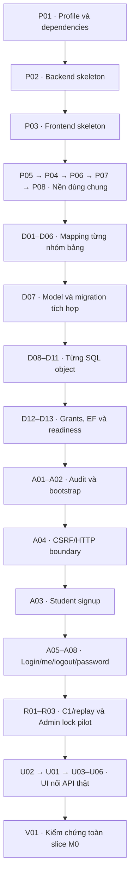

# M0 — kế hoạch task theo chất lượng

## Latest A06/A07 checkpoint — reviewed PASS, ready for main application

Owner-approved A06→A07 implementation completed and independently reviewed PASS
2026-10-06;632unit/HTTP+438SQL=1070PASS/0fail0skip/build0warnings0errors.
Two bounded AGY SUCCESS/full three contexts before write/zero observed violations;
Codex implemented/reviewed/tested JWT/current-state/transaction/HTTP integration.
A06 supplied-key framework JWT validation plus fresh Account→Session SQL guards,
exact9-field API003 /me, live CSRF resolver and explicit caller-TX activity/recheck
hook. Me/CSRF/background never renew idle; restricted scope cannot enter business.
A07 API005 revokes only current SID; commit before204/secure cookie deletion;
independent A01 security audit faults cannot restore revocation or block success.
Invalid auth cookies are removed on401 to permit deliberate anonymous CSRF/login
recovery; response remains401 and does not claim revoke success.403/500 unchanged.
Default Program stays unchanged/unmounted, no real Admin/production profile/keys/
principal or full runtime readiness. SQL cores execute only rollback fixtures;
owned SQL commit paths source-reviewed with explicit HTTP fixture commit seams,
not proof of persisted runtime/committed multi-client concurrency. No A08/restM0.
Retained dbo rows except history/test users/role memberships0;4roles102permissions/
6migrations, profile160/Latin1_General_100_CI_AS_SC/snapshotON unchanged; exact catalog
regression PASS. No schema/module/package/grant/profile/owner/logins/other DB/seed/
persistent keys/install/push/deploy change. Original worker/manager detached retained.
See A06/A07_TASK_CARD/evidence, notes/A06.md,A07.md, docs/api.md; ADR171.
Next canonical A08 password change, then R01 canonical replay registry; unstarted.
ADR163 permits applying only already authorized reviewed PASS stages.

## Historical A03/A05 checkpoint

### A03/A05 applied checkpoint (historical) — applied/reverified PASS maina9abdc6

Owner-approved A03→A05 implementation completed/reviewed PASS/applied/reverified maina9abdc6
2026-10-06; 586 unit/HTTP +409 SQL=995 PASS, 0 fail/skip, build0warnings0errors.
Two bounded AGY SUCCESS/full authorized context before write/zero observed violations;
Codex integrated, corrected and tested independently. A03 supplies strict API018
signup, caller-TX Account+StudentProfile+mandatory audit, cross-role uniqueness and
201 without auto-login. A05 supplies generic login/throttle, fresh SQL account locks,
normal/restricted session issuance, supplied JWT signing and secure cookie after commit.
Explicit API adapters remain unmounted in unchanged Program. No real Admin/profile/
keys/login resolver or runtime readiness claim. SQL cores tested in rollback-only
fixtures; HTTP commit boundaries use explicit fixture executors. Owned SQL executor
commit paths source-reviewed, not executed to persist accounts/sessions. Predicate
contention and same-transaction multiple sessions do not prove committed stress.
Only EnglishCenter_D07_20261005 used; retained Account/Profile/Session/Audit0,
D12 fixture users/role members0, four roles/exact102permissions/six migrations,
profile160/Latin1_General_100_CI_AS_SC/snapshotON unchanged; exact catalog regression PASS.
No schema/migration/package/grants/owner/profile/logins/other DB/persistent keys/
push/deploy change. Worker and manager detached evidence trees retained.
See A03/A05_TASK_CARD/evidence, docs/notes/A03.md,A05.md, docs/api.md, ADR170.
Next canonical A06 current-session/me → A07 logout; not started by this batch.
ADR163 permits applying only already authorized reviewed PASS stages.

## Historical A02/A04 checkpoint

Updated2026-10-05: owner-approved A02→A04 implementation scope complete/reviewed
PASS/applied/reverified code maina8ad1d5, managerd1612ed; identical backend tree
8a7e73f1bf9114311c9484f5c7c16d639ebd5916. A02 maindf36d98:514unit+375SQL PASS;
final545unit+375SQL=920PASS/0fail0skip/build0warnings0errors/cache-only locked restore.
Two bounded AGY SUCCESS/full3context reads before write/zero observed scope violations;
Codex independent source review, transaction/host checks and fail-closed fixes.
A02 explicit operator bootstrap: exact7roles, first Admin+projected mandatory audit on
caller SERIALIZABLE/EC:ADMINSET; repeat preserves existing Admin credentials/status.
Seven-role synthetic identities use generated RAM-only secrets and rollback. Runtime
role cannot bootstrap. No real Admin provisioned or automatic startup seed/commit.
A04 framework antiforgery API001 integration, exact Origin/header, verified-identity
boundary and safe cookie flags. No-store, no session/idle writes. Explicit origin/keys/
resolver required; private guard rejects token issuance without the boundary. Default
Program remains unmodified and API001 unexposed; test resolver/keys are fixtures only.
Only EnglishCenter_D07_20261005 used; all fixture data/schema/DENY/users/memberships
rolled back, retained0business rows/0test users/0ec-role members. Exact post-fixture
catalog/230columns/24module bodies/102permissions PASS;24tables/6migrations/4roles/
profile160/collation/snapshotON unchanged. No schema/migration/grant/profile/owner/
login/other DB/persistent keys/push/deploy change. Operator real Admin provisioning,
production profile/keys/auth resolver and full runtime readiness remain deferred.
See A02/A04_TASK_CARD/evidence, docs/notes/A02.md, A04.md and docs/api.md; ADR169.
Historical next at A02/A04 completion was A03→A05; see latest checkpoint above. ADR163 continues only for authorized reviewed PASS stages. Historical scope below.

## 1. Đầu ra M0 và nguồn hợp đồng

M0 cung cấp nền database/runtime đúng baseline và một luồng tài khoản thật:
Student tự đăng ký, login, me, logout; đổi mật khẩu thường/hạn chế; một command
Admin lock và caller-result lookup để kiểm chứng audit/replay/revocation. Các API
M0 thực hiện:001–005,018;007/010/014 cho pilot Admin. Những command Admin khác,
profile edit/home/catalogue và nhật ký UI đầy đủ tiếp tục ở các slice sau; không
được hiển thị như chức năng đã làm. Bootstrap/test fixtures không là API tạo hộ.

Nguồn: [requirements](../requirements.md), [E03](../design/DATABASE_SPEC.md),
[catalog API/F/W](../design/E04_CONTRACT_CATALOG.md),
[DTO](../design/E04_DTO_SPEC.md), [C1/replay](../design/E04_REPLAY_SPEC.md),
[SQL/locks/grants](../design/E04_SQL_INTEGRATION_SPEC.md),
[runtime/readiness](../design/E04_RUNTIME_PROFILE.md),
[final contract](../design/E04_FINAL_CONTRACT.md), ADR119/140/141/142/160/162.
W01/W02/W03 là trace chính; API007 chỉ Admin NORMAL, lock010 TX13 không đổi
quyền hoặc thêm API pilot. Lookup014 đúng action đã triển khai; các action chưa
triển khai không được trả success giả. Canonical registry55actions vẫn theo E04.

## 2. Điều đã kiểm tra và prerequisite

- Snapshot docs1054888; clean dispatch base72696e5; P02 review d9eb194 → main df7cd9a.
- .NET SDK10.0.200, Node24.16.0, npm11.13.0 hiện có. P02 SDK/package/test-host
  compatibility đã kiểm chứng; [manifest](M0_LOCAL_PROFILE.md) có pins/locks/audit.
- Local SQL `.\SQLEXPRESS`: ProductVersion17.0.1000.7, Express Edition64-bit,
  đọc bằng Windows authentication ngày04/10/2026; không đổi DB/config.
- SQL2025 Express hiện có được giữ theo ADR-162 sau
  [assessment](SQL_INSTANCE_ASSESSMENT.md); bỏ prerequisite cài Developer2022.
  Observed build17.0.1000.7 RTM không là latest patch pin. Target DB/EF160,
  snapshot ON và least-privileged runtime cần explicit profile khi tạo DB riêng.
  Không cấu hình lại17DB có sẵn; không cài mới/update hoặc claim EF/grants pass.
- LOCAL_DEV cần concrete origin/HTTPS/secret refs/finite budgets và test isolation.
  Mọi thiếu sót vẫn fail closed; không âm thầm tắt Secure/CSRF/readiness để demo.
  Không hỏi lại D12/D13; prerequisite local execution sẽ được xử lý riêng khi
  owner cho phép phạm vi tương ứng. Không từ planning mở LAN/Internet.
- Analyze AGY và bounded P02 edit đã kiểm chứng. Contract quyền đọc phải rõ, vì lần
  smoke đầu đọc extra file đã bị loại. Codex giữ bootstrap/secrets/config đặc quyền.

## 3. Cách chia và chọn task kế tiếp

Mỗi task có một đầu ra kiểm được. Tasks bảng dưới là families; chỗ có nhiều
object được bung thành một task/object trước dispatch. Không giao cả M0/nhóm
schema hoặc auth module trong một prompt. Luôn dự trù code, tests và giải thích;
không coi token limit là lý do bỏ failure path. File/diff caps sẽ được chọn từ
phạm vi thực tế trước validate, không dùng một con số cho mọi loại task.

Task chỉ `done` khi kiểm chứng của task đạt. Slice tích hợp chỉ `done` sau
build + real SQL/API/browser evidence cho toàn luồng và toàn hợp đồng liên quan.
Không task phụ thuộc nào dùng baseline chưa review. Thay đổi worker nằm trong
worktree đến khi owner cho phép áp dụng; Codex không tự merge vào main.

## 4. Nền project và biểu diễn

| ID | Đầu ra của một task | Phụ thuộc | Kiểm chứng của Codex |
| --- | --- | --- | --- |
| P01 | Hồ sơ công cụ/package compatibility và LOCAL_DEV prerequisite được trình rõ, không chứa secret | Không | Phiên bản thật; package provenance/pins trước restore; SQL edition/profile thiếu được ghi rõ. |
| P02 | Backend/test skeleton theo layout đã chốt, không business routes | P01 phần SDK/package | Build và discovery test target; không health-ready giả khi profile/DB thiếu. |
| P03 | Frontend skeleton, scripts build/lint/typecheck rõ, chưa màn hình nghiệp vụ | P01 phần Node/package | Các scripts chạy thật; không thêm thư viện chưa duyệt hoặc API mocks thành success. |
| P04 | Bộ chuẩn hóa nonsecret text/email/phone/DOB | P02,P05 | Unicode/code point/NFC/surrogate, blank/NULL, duplicate-equivalence và ngày Việt Nam. |
| P05 | Clock/time abstractions và conversion | P02 | UTC milliseconds, ngày Việt Nam, cutoff equality bằng clock kiểm soát; không tùy timezone máy. |
| P06 | Parser/version và numeric representations | P02 | UUID strict/8-byte padded Base64 RV, tiền chuỗi exact, precision/range; tách RV và numeric thành task riêng nếu lớn. |
| P07 | Error envelope và binding/error precedence | P02,P04–06 | Accepted status/code/fieldErrors/traceId; malformed input; không stack/SQL/PII leak. |
| P08 | Credential hashing/blocklist/password validation | P01,P02 | Nguồn offline/license/hash được chốt trước dùng; giữ password nguyên; generator/hash/secret handling thực tế. |

Các filename/class chưa tồn tại; names tại dispatch phải theo layout hiện có
sau skeleton. Các abstraction phục vụ accepted flow, không tạo generic framework.

## 5. Database foundation — đầy đủ cấu trúc, chưa đủ caller evidence

Đề xuất xây toàn bộ cấu trúc E03 trước readiness tích hợp M0, nhưng sinh từng
nhóm nhỏ rồi rà. Không giao24tables/230fields trong một lần. Các nhóm bên dưới
là ownership mapping, không tự quyết migration order; manifests liệt kê toàn FK,
composite relationships, filtered unique, checks/defaults/RV và index candidates.

| ID family | Phạm vi cấu trúc | Phụ thuộc và kiểm chứng |
| --- | --- | --- |
| D01 | T01–T04 Role/Account/StudentProfile/AuthSession | P02; exact E03 mapping và Account/session constraints. |
| D02 | T05–T08 Course/Band/TrainingProgram/ScoreComponentConfig | D01; kinds, numeric types, uniqueness/config relations. |
| D03 | T09–T13 Registration/EntrySession/Attempt/Booking/BandAssignment | D01,D02; split into Registration/session, Attempt/Booking, BandAssignment tasks; composite/cycle relationships kept. |
| D04 | T14–T16 Class/Assignment/Schedule | D01–D03; obligation/replacement/current schedule relations; split if diff too large. |
| D05 | T17–T19 Attendance/Score/GradeReport | D02,D04; missing versus0, required schedule linkage, finalized-only stored score. |
| D06 | T20–T24 Invoice/Payment/AuditLog/ReplayOperation/InvoiceNumberCounter | D01,D03; split financial/counter and audit/replay tasks; exact digest/retention/secret-free constraints. |
| D07 | Model assembly and reviewed migration chain | D01–D06; FK creation order and indexes reviewed; apply to isolated fresh SQL2025 Express only when authorized; inspect schema, no runtime auto-migration. |
| D08 | Five accepted triggers, each one bounded task | D07; multi-row semantics and negative tests; exact E03 purpose, no audit trigger. |
| D09 | Six accepted UDFs, each one bounded task | D07; pure/read semantics, precision/missing behavior, exact signature. |
| D10 | Six accepted views, each one bounded task | D07 and referenced objects; correct projection/aggregation; no added web rights. |
| D11 | Seven accepted SPs, each one bounded task | D07–D10 as required; exact signatures/result sets/transaction ownership and SQL case tests. |
| D12 | Four SQL roles/grants and schema/maintenance separation | D07–D11; actual allowed and forbidden principal operations; not dbo runtime. |
| D13 | SQL compatibility/readiness and EF trigger/OUTPUT integration | D07–D12; full expected signature/schema checks and EF writes to5affected tables; isolated failures/missing objects fail closed. |

Các ID task M0.D12/M0.D13 trong bảng không phải hai owner-review decisions
D12/D13 đang hoãn; khác namespace, không thay trạng thái owner decisions.

D01–D06 model fragments may build with technical test hosts; they are not a ready
application. No partial schema readiness exemption is introduced. Keep migration
history readable; do not edit applied migrations to repair later fragments.
D08–D11 creation/SQL unit evidence does not prove application callers implemented:
caller-specific E03/E04 trace and transaction tests remain with M1–M4 functions.
If full readiness requires objects whose implementation depends on a later service,
finish their structural/SQL contracts first or leave readiness blocked; never use
count-only/stub objects to pass. Full24table/5TG/6VW/6FN/7SP target retained.

## 6. Identity backend, audit và replay

| ID | Đầu ra của task | Phụ thuộc | Các ca quan trọng |
| --- | --- | --- | --- |
| A01 | Audit writer: mandatory atomic and security fallback paths | D06,D07,P05,P07 | Mandatory failure rolls back; security failure không phục hồi quyền/phiên; secret-free allowlist. |
| A02 | Bootstrap7roles/Admin và test identities tách biệt | D07,P08 | Không password seed trong source/migration/log; runtime không quyền bootstrap/migrate; repeat không tạo trùng/ghi đè. |
| A03 | API018 Student signup service/API | D07,P04,P05,P07,P08,A01,A04 | TX01 Account+Profile atomic, normalized email/phone race, invalid DOB/password, no auto-login/UUID/retry. |
| A04 | API001 CSRF and safe HTTP/cookie boundary | P01,P07 | Same-origin/Secure flags/Origin, anonymous và authenticated context, no-store, token RAM. |
| A05 | API002 login/throttle and session issuance | A02,A04,D01,P08,A01 | Generic failure privacy;5failures/15min; status vs throttle; restricted/normal scope; concurrent login counters. |
| A06 | API003 me and reusable current-session authorization | A05,P05 | Account/version/revocation/absolute2h/idle30min checks; me không gia hạn idle; deny restricted business access. |
| A07 | API005 current-session logout | A06,A01 | Server revoke, other devices remain; failure/log handling; no credential replay. |
| A08 | API004 password change and restricted scope lifecycle | A06,P08,A01 | Current password, RV conflict, temp24h/restricted10min bounds, atomic all-session invalidation. |
| R01 | Canonical registry/C1 digest primitives | P04–P06 |55actions exact, full intent/ordered versus sets, accepted literal UTF8 hashes and negative equality; no secrets. |
| R02 | Completion storage/TX protocol and scoped lookup primitives | D06,D07,A01,A06,R01 | Caller/action/key uniqueness;24h expiry; retained expired409/lookup404; current rights/order; no response/secret snapshots. |
| R03 | API007 Admin detail, API010 lock and API014 lock-result lookup | A06,A01,R02,D12 | Split detail and atomic lock/lookup integration if needed; self/last-active concurrency, current rights, revoke races, lost-response/different-intent/stale409. |

Backend integration tests require actual SQL2025 Express for locks/RV/audit/
replay/constraints. Tests that use a pure codec/clock do not require SQL; SQLite
cannot substitute for SQL Server-specific evidence. Do not implement other Admin
commands or return fake successful effects. Partial routes stay unexposed until
required profile/database/authorization is in place.

## 7. Frontend và nghiệm thu slice M0

| ID | Đầu ra của task | Phụ thuộc | Kiểm chứng |
| --- | --- | --- | --- |
| U01 | Shared fetch/error/auth state and session-scope boundary | P03,A04–A07 | No token/PII in URL/storage, stale response discard, RAM cleanup, no automatic credential/write replay. |
| U02 | Common form/control and shell primitives needed for identity | P03 | Accepted FE tokens/system font/labels/focus; build/lint/typecheck; no extra UI kit. |
| U03 | F02 signup UI connected to API018 | U01,U02,A03 | Field/form errors, unknown response/recovery, no auto-login;375/768/1280. |
| U04 | F01 login/me/logout and cross-tab signals | U01,U02,A05–A07 | Normal/restricted routing, timers/activity semantics, cache clearing; browser evidence. |
| U05 | Account password-change UI | U04,A08 | No secret persistence/auto retry; restricted-only actions; must re-login after success. |
| U06 | Minimal F32 Admin detail/lock pilot UI | U04,R03 | Visible actual operation only; preview impact/reload/version conflict and lock-result lookup; no fake menus/actions. |
| V01 | Integrated M0 verification, residual trace and owner walkthrough | D13,A03–A08,R03,U03–U06 | Real SQL/API/browser happy/failure/race paths, all7role scope matrix where applicable, trace W01–03; no app caller evidence claimed for later modules. |

M0 completion is not acceptance of remaining F32 commands, all audit UI, all55UUID
command callers or full product. Mandatory audit/replay used by implemented callers
must be complete; pending caller coverage stays explicit. Never mark V01done merely
because builds pass. Remaining browser/SQL/profile evidence blocks relevant claims.

## 8. Ba task đầu: scope đủ review, chưa dispatch

P01 manager-owned planning/preflight: update only this plan and a future
`docs/plan/M0_LOCAL_PROFILE.md`/compatibility manifest when concrete values are
resolved. Inventory is read-only. Forbid source changes, installs, DB DML/DDL,
secret files and public exposure. Do not put credentials/connection strings/keys
in documents. SQL edition prerequisite is resolved by ADR-162; package pins/concrete LOCAL_DEV
profile remain prerequisites, not a completed code task.

P02 backend skeleton proposed scope:
`backend/EnglishCenter.sln`, `backend/src/EnglishCenter.Api/EnglishCenter.Api.csproj`,
`backend/src/EnglishCenter.Api/Program.cs`,
`backend/tests/EnglishCenter.Tests/EnglishCenter.Tests.csproj`,
`backend/tests/EnglishCenter.Tests/Infrastructure/StartupTests.cs` and a nonsecret
`.gitignore` update if required. Project format/package/test-host choice must be
verified before these names and caps become a runnable English worker contract.
No runtime secrets/appsettings literals, generated migrations/business controllers,
package additions beyond approved manifest or modifications of baseline docs.
Manager checks proposed: `dotnet build backend/EnglishCenter.sln` and
`dotnet test backend/tests/EnglishCenter.Tests/EnglishCenter.Tests.csproj`.
These targets do not exist yet; not executed or reported passed in planning.

P03 frontend skeleton proposed scope: `frontend/package.json`, its approved
lockfile, `frontend/index.html`, Vite/TypeScript/lint configs, `frontend/src/main.tsx`
and minimal app/styles entry files, `.gitignore` if specifically included. Exact
package manifest/config filenames and scripts must be reviewed before contract;
lockfile changes allowed only for this authorized bootstrap, not later generic tasks.
Manager checks proposed: build/lint/typecheck using scripts actually added and
reviewed. Forbid business pages/mock success, new UI libraries, design/ADR edits,
credentials and deployment config. Scope may split configuration from code if large.

For every later task Codex materializes a numbered task card with exact paths,
read context/consent, base commit, dependencies, success/failure evidence and caps.
No runner contract with approximate folder-wide permission is dispatched from this
plan. Worker runs validate first, detached edit worktree, no permission bypass,
receipt/events/diff review, manager tests and owner permission before primary apply.

## 9. Những việc chưa cần owner quyết định lại

Product rules/roles/save units/stack remain accepted; D12/D13 deferred. Proposed
full structural DB groundwork is an implementation ordering recommendation, not a
new data model. Before execution, ask only necessary concrete development-profile,
package or bootstrap choices not determined by accepted contracts; bundle choices
with recommendations and actual evidence. Do not request deadline/weekly hours.

## 10. Skill selection gate

Áp dụng [SKILL_ROUTING](SKILL_ROUTING.md) mỗi task viết code. Mapping P/D/A/R/U/V
đã ghi tại policy; task card phải có selected implementation/review skills,
source revision/hash, applicable overrides và actual verification. P01 chỉ
planning không ép code skill; AGY task phải đưa selected skill files/policy vào
read scope hợp lệ trước validate. Không tự activate C2C hoặc broaden đọc/ghi.

## 11. Thứ tự mặc định đã lưu và sơ đồ

Đây là thứ tự đề xuất cụ thể để chọn task, không chỉ dựa vào sơ đồ chat.
Mỗi ID là family cần tách task con trước dispatch; không phải39lần sinh code cố
định. Mặc định tuần tự để review từng baseline; không tự tạo agent song song.
Task đang chọn đầu tiên: P01 planning/preflight, chưa bắt đầu coding.

P01 → P02 → P03 → P05 → P04 → P06 → P07 → P08.

D01 → D02 → D03 → D04 → D05 → D06 → D07 → D08 → D09 → D10 → D11 → D12 → D13.

A01 → A02 → A04 → A03 → A05 → A06 → A07 → A08 → R01 → R02 → R03.

U02 → U01 → U03 → U04 → U05 → U06 → V01.

Phụ thuộc bảng mục4–7 là điều kiện tối thiểu; thứ tự trên chủ ý bảo thủ và hợp
lệ với chúng. P05 trước P04 vì DOB dùng ngày Việt Nam/clock; A04 trước A03 vì
API signup là unsafe request cần CSRF/Origin; D07 trước audit/replay SQL tests.
SQL family/object phụ thuộc nhau phải tách theo actual E03/E04 references tại
contract. Không đổi source-state/guard/save-unit hoặc readiness để giữ thứ tự.

Đây là sơ đồ thứ tự mặc định, không mô tả mọi edge của dependency graph. Một
technical task có thể test độc lập trước full readiness nhưng không được nhận
runtime-ready hoặc integrated-flow claim. Sau M0, các nhóm coverage đề xuất
M1configuration/admissions → M2payment/class/schedule → M3teaching/publication
→ M4reports/final evidence; chi tiết task chưa lập, không giao cả nhóm một lần.

Khi phải đổi thứ tự hoặc chia ID thành task con: update bảng/dependencies,
thứ tự/sơ đồ tại đây và current memory trước bước tiếp theo, ghi lý do. Mọi
skill gate và owner permission trước apply worker changes tiếp tục giữ nguyên.

## 12. SQL target đang dùng — ADR-162 thay SQL choice của ADR-119

Giữ SQL Server2025 Express64-bit instance `.\SQLEXPRESS`, observed17.0.1000.7
RTM; không cài Developer2022 hoặc đổi edition/major. Đánh giá khả năng đáp ứng
E03/E04 và giới hạn kiểm chứng ở [SQL_INSTANCE_ASSESSMENT](SQL_INSTANCE_ASSESSMENT.md).
DB mới và EF provider dùng compatibility160 để giữ E03 types/SQL semantics;
chưa cấu hình DB, EF integration và migration phải kiểm ở D07/D13.

Express giới hạn50GB/database, buffer pool1410MB, lesser1socket/4cores; không
SQL Agent/native backup encryption. Backup cần scheduler ngoài engine và archive
mã hóa giữ nguyên ADR-118; media/key/tool/restore còn DF03. Build RTM không mới
nhất: review compatible17.x patch trước dữ liệu thật/exposure; không tự cài.
Thứ tự39families, skill/quality gates, D12/D13 owner-deferred không đổi.
