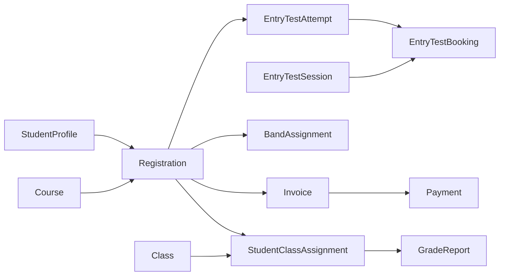

# 6.1 — Đối chiếu sơ đồ logic

Ngày đối chiếu: 14/10/2026. Nguồn báo cáo: `Nhom18_ThietKeXuLy.docx`, phần VI. Bản Word gốc được giữ nguyên.

“Hiện tại” trong tài liệu là schema/SQL/service trong source dự án, đối chiếu InitialSchema, EF snapshot/configurations và ExpectedCatalog; không phải kết quả truy vấn SQL live ở lượt này. Không chạy migration, sửa database hoặc chạy lại các bộ test.

## 1. Kết luận

**Hình 6.1 cần vẽ lại**, không chỉ đổi vài nhãn. Hình còn ba bảng học bổng ngoài phạm vi và thiếu năm bảng trong schema hiện tại. Mục 6.2 đã dùng 22 bảng nghiệp vụ mới nên không đồng nhất với hình này dù cùng có thể thấy 22 hộp bảng.

[Ảnh gốc trích từ 6.1](report-268-0.png). Việc trích ảnh không sửa ảnh hay Word nguồn.

## 2. Đối chiếu từng nhóm quan hệ

| Nội dung | Trong hình báo cáo | Hiện tại | Sửa báo cáo |
| --- | --- | --- | --- |
| ScholarshipGrant / ScholarshipCandidate / ScholarshipCriteria | Cả ba còn trong hình | Không có trong schema hoặc phạm vi requirements | Sai phạm vi; bỏ cả bảng và liên kết. |
| Attempt → Session | Đường nối trực tiếp | Registration → Attempt → Booking → Session | Thay đường nối; Attempt không có session_id. |
| StudentProfile → Course | Đường nối trực tiếp | Liên hệ qua Registration.student_id/course_id | Không vẽ thành FK trực tiếp. |
| Course → Band | Đường nối trực tiếp trong hình | Course/Band là hai FK của TrainingProgram | Đặt TrainingProgram làm liên kết theo cặp Course/Band. |
| Assignment → StudentProfile | Đường nối trực tiếp | Assignment.registration_id → Registration.student_id → Profile | Thay bằng đường qua Registration. |
| AuthSession | Chưa có | Phiên → Account | Bổ sung bảng và quan hệ. |
| EntryTestBooking | Chưa có | Booking → Attempt/Session và FK result ngược Attempt | Bổ sung; phân biệt lượt logic với lịch hẹn. |
| AuditLog | Chưa có | Actor Account optional, operation/entity correlation | Bổ sung; không FK giả entity_id tới mọi bảng. |
| ReplayOperation | Chưa có | Receipt → Account actor | Bổ sung bảng kỹ thuật, không màn hình mới. |
| InvoiceNumberCounter | Chưa có | Bộ cấp số theo năm, không FK sang Invoice | Bổ sung riêng; liên hệ chức năng không là FK. |

Các đường nối nhận xét trên dựa vào hình đã xem; không dùng chúng để suy ra PK/FK vật lý chưa ghi. Danh mục 50 FK chính xác có ở [6.3.4](6_3_4_RANG_BUOC_THAM_CHIEU.md).

## 3. Đường dữ liệu nghiệp vụ đúng để vẽ

Đây là sơ đồ đường dữ liệu đọc từ cha tới con để giải thích, **không là hướng FK hoặc mô hình đủ 24 bảng**. Khi vẽ schema, dùng bảng con → bảng cha theo cột ở 6.3.4. Best/Band còn tham chiếu Attempt/Band; Class tham chiếu Program/Teacher; các FK actor cần thể hiện hoặc tách trang.

## 4. Bố cục nên dùng khi thay hình

1. Tài khoản: Role, Account, StudentProfile, AuthSession.
2. Cấu hình: Course, Band, TrainingProgram, ScoreComponentConfig.
3. Đăng ký/đầu vào: Registration, EntryTestSession, EntryTestAttempt, EntryTestBooking, BandAssignment.
4. Đào tạo: Class, StudentClassAssignment, Schedule, Attendance, Score, GradeReport.
5. Tài chính: Invoice, Payment, InvoiceNumberCounter.
6. Xuyên suốt: AuditLog, ReplayOperation.

Chú giải phân biệt quan hệ FK với xử lý cùng giao dịch hoặc operation correlation. Tránh nối InvoiceNumberCounter→Invoice hay AuditLog.entity_id→mọi bảng như FK. Đánh dấu các quan hệ 0..1 từ nullable/unique và dùng note cho nghĩa vụ “phải tạo cùng transaction”.

## 5. Đoạn thuyết minh thay thế

Schema hiện tại gồm 24 bảng do ứng dụng quản lý: 22 bảng nghiệp vụ và hai bảng kỹ thuật ReplayOperation, InvoiceNumberCounter. Học viên đăng ký khóa qua Registration; mỗi hồ sơ có tối đa hai lượt thi logic EntryTestAttempt, mỗi lượt có lịch sử EntryTestBooking liên kết ca thi. Duyệt hồ sơ phát hành Invoice; xác nhận thu tiền tạo Payment. Học viên đủ điều kiện được xếp qua StudentClassAssignment gắn Registration với Class, đồng thời tạo GradeReport DRAFT. Lịch có occurrence và nghĩa vụ buổi riêng để giữ lịch sử thay thế. Tài khoản/phiên, audit và replay phục vụ kiểm quyền, lịch sử và giao dịch, không bổ sung các chức năng học bổng.

Nguồn dùng chung và phương pháp: [README](README.md).
