# Mô tả 27 giao diện quan trọng của hệ thống

Bản thảo phục vụ báo cáo, đối chiếu giao diện và mã nguồn ngày 15/10/2026. Chọn 27 giao diện chính từ bộ 117 ảnh, bao quát khách và bảy vai trò. Mỗi giao diện có một ảnh chính; ảnh bổ sung minh họa các trạng thái tạo, sửa hoặc xem trước của cùng nhóm chức năng. GD01–GD27 là số thứ tự trình bày trong báo cáo, không thay mã F hoặc mã use case đã thống nhất.

## Quy ước mô tả

Bảng có đúng bốn cột: **STT – Loại – Ý nghĩa – Biến cố/Xử lý**. STT đánh lại từ 1 trong từng bảng; không phải số đang gắn sẵn trên ảnh. Loại mô tả điều khiển người dùng nhìn thấy: Button, TextBox, PasswordBox, DatePicker, TimePicker, NumberBox, ComboBox, CheckBox, RadioButton, TextArea, Table, Card, Label, Badge hoặc Dialog.

Ý nghĩa ghi tên hoặc nhãn thực tế và mục đích sử dụng. Biến cố/Xử lý ghi sự kiện rồi kết quả: chuyển đến GD nào, mở hộp thoại, đọc dữ liệu vào phần bên dưới, cập nhật bản nhập hay lưu nghiệp vụ. Thành phần chỉ đọc ghi rõ không có thao tác chỉnh sửa. Nhiều ô cùng loại/cùng cách xử lý được nhóm trong một dòng; các nút có kết quả khác nhau được tách dòng.

Không mặc định bấm “Xem” là chuyển sang trang khác: nhiều màn hình mở chi tiết ngay trong trang hiện tại. Không mô tả nhập chữ/chọn bộ lọc là tự gửi truy vấn khi ứng dụng yêu cầu bấm “Tìm”, “Đọc” hoặc “Áp dụng bộ lọc”. Nút bị vô hiệu hóa không thực hiện thao tác; điều kiện cho phép tùy quyền, trạng thái và dữ liệu hiện tại.

Các dòng ghi “trong biểu mẫu”, “trong hộp thoại” hoặc “khi chọn…” chỉ áp dụng sau khi mở trạng thái tương ứng, không có nghĩa mọi điều khiển cùng hiện trên ảnh chính. Ảnh là dữ liệu demo; mã hồ sơ, hóa đơn, lớp hoặc tài khoản cụ thể trong nhãn được viết thành “[mã]” trong bảng.

## Thành phần dùng chung

Ảnh bổ sung: [Menu điện thoại](images/111.png), [Đổi mật khẩu](images/016.png), [Sửa thông tin cá nhân](images/070.png).

| STT | Loại | Ý nghĩa | Biến cố/Xử lý |
|---|---|---|---|
| 1 | Button | Các mục điều hướng theo vai trò ở đầu trang hoặc thanh bên. | Click mở nhóm giao diện tương ứng trong danh sách GD01–GD27; chỉ hiển thị các mục được cấp cho vai trò hiện tại. |
| 2 | Button | Menu tài khoản ở góc trên. | Click mở/đóng danh sách thao tác tài khoản; không tự thay đổi thông tin. |
| 3 | Button | “Thông tin cá nhân” của học viên, nằm trong menu tài khoản. | Click mở phần thông tin cá nhân trong khu vực học viên. “Sửa thông tin cá nhân” mở biểu mẫu họ tên, ngày sinh, điện thoại và địa chỉ; email chỉ đọc. |
| 4 | Button | “Đổi mật khẩu”, nằm trong menu tài khoản. | Click mở biểu mẫu có mật khẩu hiện tại, mật khẩu mới và nhập lại mật khẩu mới; gửi biểu mẫu để kiểm tra và đổi mật khẩu, các trường không tự lưu khi nhập. |
| 5 | Button | “Đăng xuất”, nằm trong menu tài khoản. | Click kết thúc phiên đang sử dụng và trở về đăng nhập GD01. |
| 6 | Button | Nút mở menu trên điện thoại hoặc thu gọn thanh bên nhân viên. | Click đổi trạng thái hiển thị điều hướng; không thực hiện nghiệp vụ. |
| 7 | Label | Thông báo đang tải, thành công, lỗi hoặc chưa có dữ liệu. | Được cập nhật theo kết quả xử lý; thông báo không phải nút chuyển trang. |
| 8 | Button | Các nút kiểm tra/đối chiếu khi kết quả một lệnh chưa xác định. | Chỉ hiện trong trạng thái cần khôi phục. Click tra cứu kết quả hoặc đọc dữ liệu mới để đối chiếu; không tự gửi lại lệnh nghiệp vụ. |

## GD01. Đăng nhập

**Vai trò:** Khách; sau đăng nhập chuyển theo vai trò. **Mã liên quan:** F01.

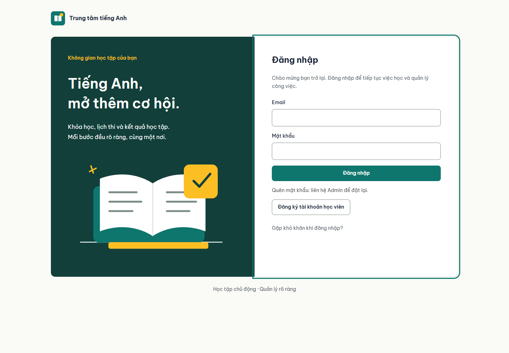

| STT | Loại | Ý nghĩa | Biến cố/Xử lý |
|---|---|---|---|
| 1 | TextBox | Ô “Email”, nhập email đăng nhập. | Nhập/cập nhật email trong biểu mẫu; chưa gửi yêu cầu đăng nhập. |
| 2 | PasswordBox | Ô “Mật khẩu”, nhập mật khẩu tài khoản. | Nhập mật khẩu được che ký tự; giá trị được xóa sau lần gửi đăng nhập. |
| 3 | Button | Nút “Đăng nhập”. | Click hoặc gửi biểu mẫu để kiểm tra thông tin. Thành công mở trang theo vai trò: học viên GD03, tuyển sinh GD11, giáo vụ GD13, giáo viên GD19, kế toán GD23, giám đốc GD25, Admin GD26. Nếu tài khoản bắt buộc đổi mật khẩu, mở biểu mẫu đổi trước khi vào nghiệp vụ. |
| 4 | Button | Nút “Đăng ký tài khoản học viên”. | Click chuyển sang GD02. |
| 5 | Label | Khu vực thông báo và thời gian cần chờ khi đăng nhập bị từ chối. | Hiển thị kết quả kiểm tra; người dùng sửa thông tin hoặc đợi theo thông báo. |
| 6 | Button | Mục “Gặp khó khăn khi đăng nhập?” và nút “Kiểm tra lại phiên” bên trong. | Mở phần trợ giúp; Click “Kiểm tra lại phiên” kiểm tra trạng thái phiên hiện tại. |
| 7 | Button | “Lấy ngữ cảnh đăng nhập”, chỉ hiện khi chưa chuẩn bị được ngữ cảnh gửi. | Click chuẩn bị lại để có thể gửi biểu mẫu đăng nhập; không tự tạo tài khoản. |

## GD02. Đăng ký tài khoản học viên

**Vai trò:** Khách. **Mã liên quan:** F02.

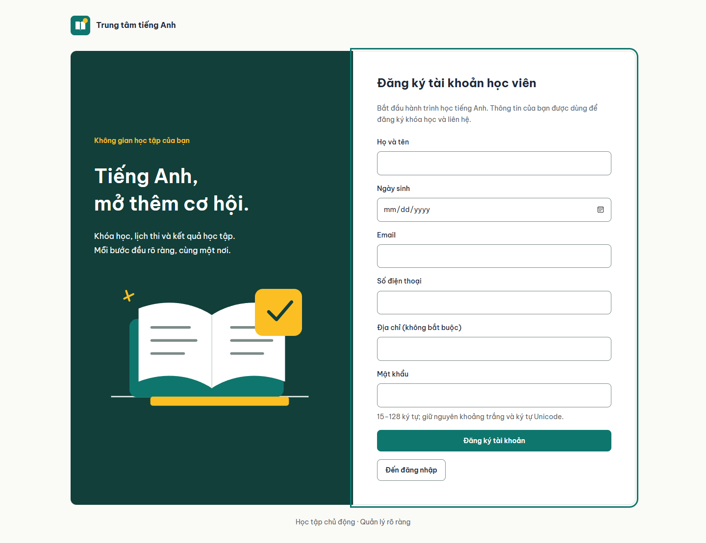

| STT | Loại | Ý nghĩa | Biến cố/Xử lý |
|---|---|---|---|
| 1 | TextBox | Ô “Họ và tên”. | Nhập họ tên cho tài khoản và hồ sơ học viên mới. |
| 2 | DatePicker | Ô “Ngày sinh”. | Chọn ngày sinh hợp lệ; không chọn ngày trong tương lai. |
| 3 | TextBox | Ô “Email”. | Nhập email dùng để đăng nhập; khi gửi, hệ thống kiểm tra định dạng và trùng dữ liệu. |
| 4 | TextBox | Ô “Số điện thoại”. | Nhập số điện thoại di động Việt Nam; khi gửi, kiểm tra tính hợp lệ và trùng dữ liệu. |
| 5 | TextBox | Ô “Địa chỉ (không bắt buộc)”. | Nhập địa chỉ hoặc để trống. |
| 6 | PasswordBox | Ô “Mật khẩu”. | Nhập mật khẩu cho tài khoản mới; hệ thống kiểm tra theo quy tắc mật khẩu khi gửi. |
| 7 | Button | Nút “Đăng ký tài khoản”. | Click kiểm tra biểu mẫu và tạo tài khoản học viên nếu hợp lệ. Thành công chuyển về đăng nhập GD01; không tự gán vai trò nhân viên. |
| 8 | Button | Nút “Đến đăng nhập”. | Click trở về GD01. |
| 9 | Label | Lỗi tại từng trường hoặc thông báo chung. | Hiển thị trường cần sửa và kết quả đăng ký; không tự gửi lại khi kết quả chưa xác định. |

## GD03. Trang chủ học viên

**Vai trò:** Học viên. **Mã liên quan:** F03.

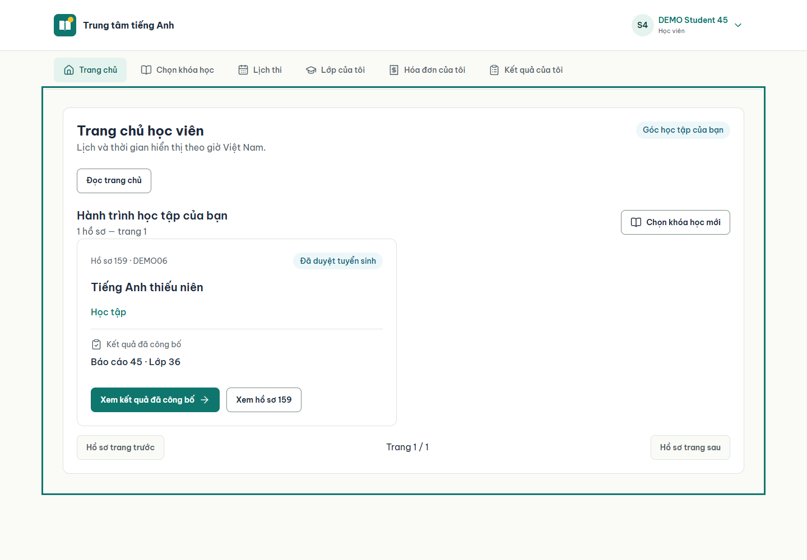

Ảnh bổ sung: [Chưa có hồ sơ](images/073.png).

| STT | Loại | Ý nghĩa | Biến cố/Xử lý |
|---|---|---|---|
| 1 | Button | “Đọc trang chủ”. | Click đọc lại các hồ sơ và thông tin tổng quan của chính học viên. |
| 2 | Card | Thẻ hồ sơ: mã hồ sơ, khóa học, trạng thái và bước hiện tại. | Chỉ hiển thị thông tin của từng hồ sơ; không tự mở chi tiết khi bấm vào vùng chữ. |
| 3 | Label | Lịch gần nhất, học phí chưa thanh toán, kết quả đã công bố hoặc lý do đang chờ. | Hiển thị theo dữ liệu của hồ sơ; không tự xác nhận thanh toán hoặc công bố điểm. |
| 4 | Button | “Chọn khóa học mới”; khi chưa có hồ sơ có “Khám phá khóa học”. | Click mở GD04. |
| 5 | Button | “Xem hồ sơ [mã]”. | Click đọc và mở chi tiết hồ sơ GD05 ngay trong khu vực học viên. |
| 6 | Button | Nút bước tiếp theo trên mỗi thẻ, như “Xem bước đặt lịch”, “Xem bước xác nhận nhập học”, “Xem hóa đơn”. | Click mở dữ liệu/bước phù hợp của chính hồ sơ: đặt lịch GD06, xác nhận trong GD05, hóa đơn GD08, lớp GD09 hoặc kết quả GD10; việc bấm nút dẫn tới bước xem, chưa tự hoàn tất nghiệp vụ. |
| 7 | Button | “Xem kết quả [mã]” khi có báo cáo đã công bố. | Click mở chi tiết kết quả học tập GD10. |
| 8 | Button | “Hồ sơ trang trước”, “Hồ sơ trang sau”. | Click đọc trang hồ sơ liền trước/liền sau; vô hiệu hóa khi không còn trang phù hợp. |

## GD04. Chọn khóa học và đăng ký khóa

**Vai trò:** Học viên. **Mã liên quan:** F04, phần tạo hồ sơ của F05.

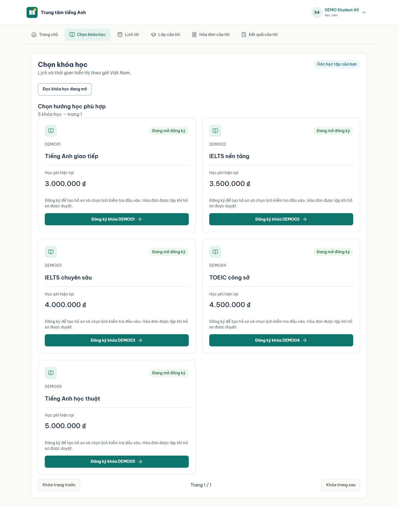

Ảnh bổ sung: [Hộp thoại đăng ký khóa học](images/074.png).

| STT | Loại | Ý nghĩa | Biến cố/Xử lý |
|---|---|---|---|
| 1 | Button | “Đọc khóa học đang mở”. | Click đọc lại danh sách khóa đang cho phép đăng ký. |
| 2 | Card | Thẻ khóa học, gồm mã, tên, học phí hiện tại và nhãn đang mở đăng ký. | Hiển thị thông tin để lựa chọn; học phí trên thẻ chưa phải một hóa đơn đã phát hành. |
| 3 | Button | “Đăng ký khóa [mã]”. | Click mở hộp thoại “Xác nhận thay đổi” cho khóa đã chọn; chưa tạo hồ sơ ngay. |
| 4 | Dialog | Hộp thoại nêu khóa học và ý nghĩa tạo hồ sơ. | Hiển thị nội dung cần kiểm tra trước khi gửi; hóa đơn chỉ được phát hành ở bước duyệt tuyển sinh. |
| 5 | Button | “Xác nhận” trong hộp thoại đăng ký. | Click gửi yêu cầu tạo hồ sơ; thành công mở dữ liệu hồ sơ mới để đối chiếu ở GD05. |
| 6 | Button | “Quay lại” hoặc nút đóng hộp thoại. | Click hủy ý định đang xem, quay lại danh sách khóa và không tạo hồ sơ. |
| 7 | Button | “Khóa trang trước”, “Khóa trang sau”. | Click đọc trang khóa học trước/sau. |

## GD05. Chi tiết hồ sơ, kết quả đầu vào và xác nhận nhập học

**Vai trò:** Học viên. **Mã liên quan:** F05, F08, F09.

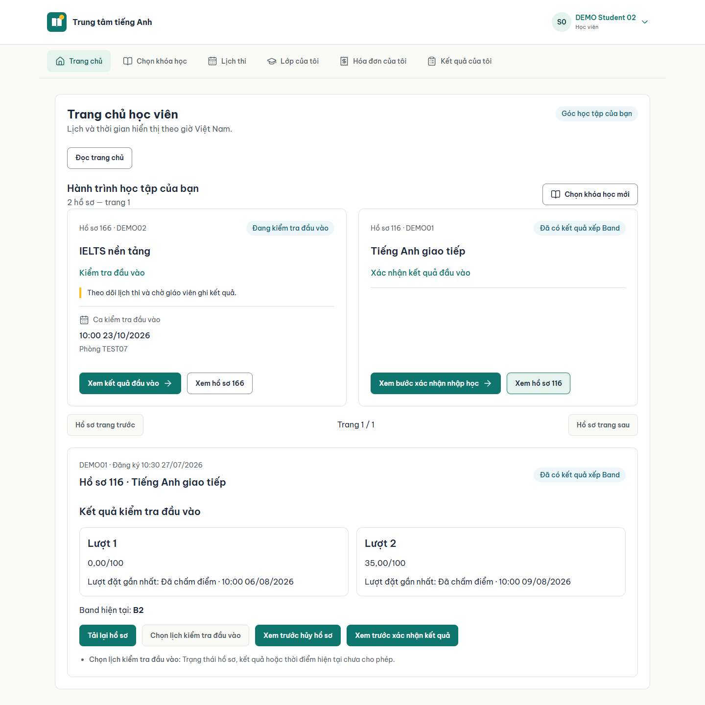

Ảnh bổ sung: [Hồ sơ chờ xác nhận](images/100.png), [Xem trước xác nhận](images/101.png).

| STT | Loại | Ý nghĩa | Biến cố/Xử lý |
|---|---|---|---|
| 1 | Label, Badge | Mã hồ sơ, khóa học, ngày đăng ký, trạng thái; thông tin hóa đơn/lớp nếu đã có. | Chỉ hiển thị dữ liệu của hồ sơ được chọn. |
| 2 | Card | Từng lượt thi, điểm, lượt đặt hiện tại hoặc lượt đặt gần nhất. | Chỉ đọc kết quả và lịch sử; học viên không sửa điểm đầu vào. |
| 3 | Label | “Band hiện tại”. | Hiển thị Band do hệ thống xác định từ kết quả hợp lệ; không có ô để học viên tự chọn Band. |
| 4 | Button | “Tải lại hồ sơ”. | Click đọc lại chi tiết hồ sơ đang mở. |
| 5 | Button | “Chọn lịch kiểm tra đầu vào”. | Click đọc các ca phù hợp và mở GD06 khi hồ sơ cho phép đặt lịch. |
| 6 | Button | “Đổi lịch lượt đặt [mã]”, tại lượt đang đặt và đủ điều kiện. | Click mở GD06 ở chế độ chọn ca thay thế cho đúng lượt đặt. |
| 7 | Button | “Hủy lượt đặt [mã]”. | Click mở hộp thoại xác nhận hủy lượt đặt; chỉ gửi hủy sau khi xác nhận. |
| 8 | Button | “Xem trước hủy hồ sơ”. | Click đọc điều kiện/tác động và mở hộp thoại hủy hồ sơ; hiển thị các lượt đặt tương lai và hóa đơn chưa thanh toán sẽ bị ảnh hưởng. |
| 9 | Button | “Xem trước xác nhận kết quả”. | Click mở hộp thoại kết quả đầu vào, điểm từng lượt và Band; chỉ cho tiếp tục nếu đủ điều kiện xác nhận nhập học. |
| 10 | Button | “Xác nhận” trong hộp thoại xem trước hủy hồ sơ/xác nhận kết quả. | Click gửi yêu cầu đang xem. Nếu là xác nhận nhập học, hồ sơ chuyển sang chờ tuyển sinh xét duyệt; nếu là hủy thì thực hiện theo tác động đã xem. |
| 11 | Button | “Đóng” hộp thoại xem trước. | Click đóng hộp thoại và trở lại hồ sơ; không hủy hồ sơ hoặc xác nhận nhập học. |
| 12 | Label | Lý do thao tác không được phép. | Hiển thị lý do nút bị khóa; không tự thay trạng thái hồ sơ. |

Lưu ý đối chiếu: UI hiện hiển thị điểm từng lượt và Band, nhưng chưa có nhãn tường minh chỉ rõ điểm tốt nhất/lượt được chọn. Không ghi thành một thành phần đã có trong ảnh.

## GD06. Chọn hoặc đổi ca kiểm tra đầu vào

**Vai trò:** Học viên. **Mã liên quan:** F06.

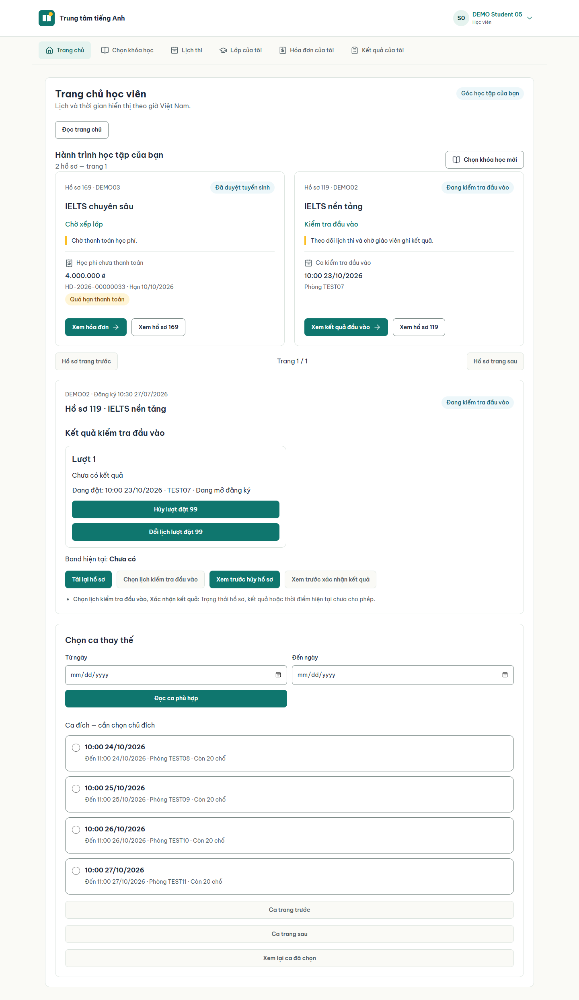

| STT | Loại | Ý nghĩa | Biến cố/Xử lý |
|---|---|---|---|
| 1 | Label | Tiêu đề “Chọn ca thi” hoặc “Chọn ca thay thế”. | Cho biết đang đặt mới hay đổi một lượt đặt hiện có. |
| 2 | DatePicker | Các ô ngày của khoảng tìm ca thi. | Thay đổi ngày cập nhật bộ lọc, làm mất lựa chọn ca và nội dung xem trước cũ; cần đọc lại danh sách. |
| 3 | Button | “Đọc ca phù hợp”. | Click truy vấn các ca theo hồ sơ, lượt thi và khoảng ngày đang chọn. |
| 4 | RadioButton | Lựa chọn một ca trong danh sách. | Chọn một ca đích; mỗi thời điểm chỉ giữ một lựa chọn, chưa đặt chỗ. |
| 5 | Label | Ngày giờ, phòng và số chỗ còn của từng ca. | Chỉ đọc để so sánh; số chỗ sẽ được kiểm tra lại khi xác nhận, không được giữ chỗ khi xem. |
| 6 | Button | “Ca trang trước”, “Ca trang sau”. | Click đọc trang ca trước/sau theo cùng bộ lọc. |
| 7 | Button | “Xem lại ca đã chọn”. | Click kiểm tra lựa chọn và mở hộp thoại tóm tắt ca đăng ký/ca thay thế. |
| 8 | Button | “Xác nhận” trong hộp thoại. | Click gửi đặt ca hoặc đổi ca. Thành công cập nhật hồ sơ GD05; lịch sử lượt thi được giữ. |
| 9 | Button | “Quay lại” hoặc đóng hộp thoại. | Click bỏ ý định xác nhận và trở lại chọn ca, không đặt/đổi ca. |
| 10 | Label | Lý do chặn hoặc thông báo chưa có ca phù hợp. | Hiển thị kết quả kiểm tra; có thể đổi khoảng ngày và đọc lại, không tự sinh thêm ca thi. |

## GD07. Lịch thi đầu vào của học viên

**Vai trò:** Học viên. **Mã liên quan:** F07.

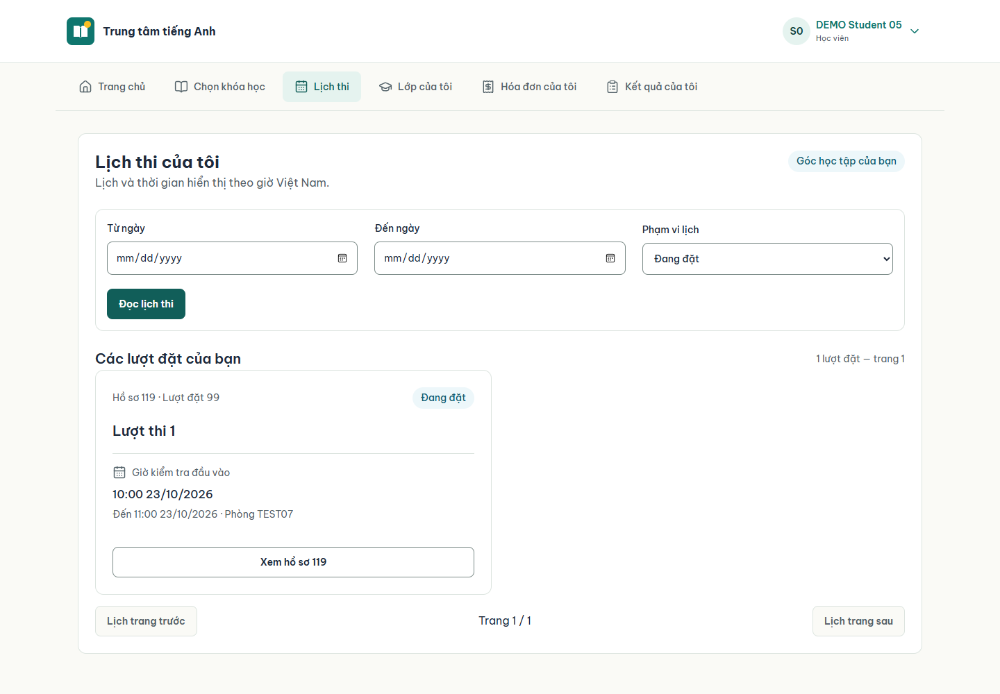

| STT | Loại | Ý nghĩa | Biến cố/Xử lý |
|---|---|---|---|
| 1 | DatePicker | Khoảng ngày xem lịch thi. | Thay đổi ngày xóa kết quả lịch đang hiển thị; bấm “Đọc lịch thi” để truy vấn lại. |
| 2 | ComboBox | “Phạm vi lịch”: Đang đặt hoặc Toàn bộ lịch sử. | Chọn phạm vi và xóa kết quả cũ; không tự gửi truy vấn. |
| 3 | Button | “Đọc lịch thi”. | Click đọc các lượt đặt của chính học viên theo bộ lọc. |
| 4 | Card | Thẻ lượt đặt: hồ sơ, số lượt, thời gian, phòng và trạng thái. | Chỉ hiển thị thông tin lượt đặt; phân biệt đang đặt, đã chấm, vắng hoặc hủy. |
| 5 | Button | “Xem hồ sơ [mã]” trên thẻ lượt đặt. | Click đọc hồ sơ tương ứng và mở chi tiết GD05 trong khu vực học viên. |
| 6 | Button | “Lịch trang trước”, “Lịch trang sau”. | Click đọc trang lịch trước/sau. |
| 7 | Label | Số lượt đặt, số trang hoặc thông báo không có lịch phù hợp. | Hiển thị kết quả tìm; không có chức năng tự tạo lịch từ màn hình này. |

## GD08. Hóa đơn và hướng dẫn thanh toán của học viên

**Vai trò:** Học viên. **Mã liên quan:** F10.

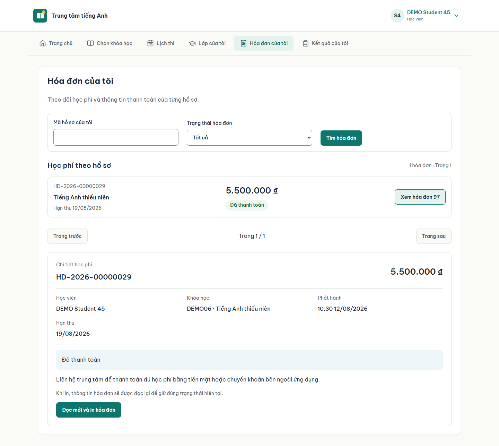

| STT | Loại | Ý nghĩa | Biến cố/Xử lý |
|---|---|---|---|
| 1 | TextBox | “Mã hồ sơ của tôi”. | Nhập mã để lọc; thay đổi giá trị xóa danh sách/chi tiết cũ và chờ tìm lại. |
| 2 | ComboBox | “Trạng thái hóa đơn”. | Chọn Tất cả, Chưa thanh toán, Đã thanh toán hoặc Đã hủy; chờ bấm tìm. |
| 3 | Button | “Tìm hóa đơn”. | Click đọc danh sách hóa đơn của chính học viên theo tiêu chí đã nhập. |
| 4 | Card | Hóa đơn trong danh sách: số hóa đơn, khóa, số tiền, hạn và trạng thái. | Chỉ hiển thị; cảnh báo quá hạn không tự hủy hồ sơ hoặc hóa đơn. |
| 5 | Button | “Xem hóa đơn [mã]”. | Click đọc chi tiết hóa đơn và hiển thị bên dưới ngay trong GD08. |
| 6 | Label | Chi tiết học viên, khóa, số tiền, phát hành, hạn thu và hướng dẫn thanh toán. | Chỉ đọc; học viên thanh toán bên ngoài ứng dụng, không có nút tự chuyển sang đã thanh toán. |
| 7 | Button | “Đọc mới và in hóa đơn”. | Click đọc lại hóa đơn theo quyền hiện tại rồi gọi chức năng in của trình duyệt; không lưu thanh toán và không tạo biên lai riêng. |
| 8 | Button | “Trang trước”, “Trang sau”. | Click đọc trang hóa đơn trước/sau. |

## GD09. Lớp và thời khóa biểu của học viên

**Vai trò:** Học viên. **Mã liên quan:** F11.

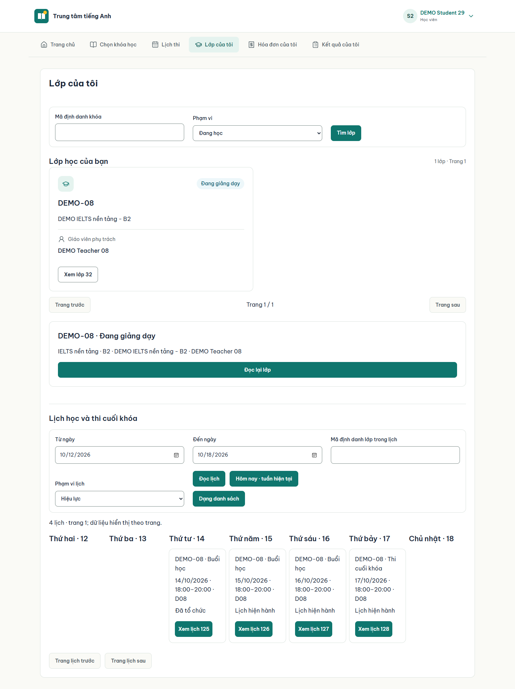

Ảnh bổ sung: [Chi tiết lớp](images/075.png).

| STT | Loại | Ý nghĩa | Biến cố/Xử lý |
|---|---|---|---|
| 1 | TextBox | “Mã định danh khóa”. | Nhập mã khóa cần lọc; thay đổi tiêu chí xóa kết quả lớp cũ và chờ tìm lại. |
| 2 | ComboBox | “Phạm vi”: Đang học hoặc Lịch sử. | Chọn nhóm lớp của chính học viên; chờ bấm “Tìm lớp”. |
| 3 | Button | “Tìm lớp”. | Click đọc danh sách lớp theo tiêu chí. |
| 4 | Button | “Xem lớp [mã]”. | Click đọc chi tiết lớp và hiển thị thông tin lớp/lịch ở GD09. |
| 5 | Label | Mã lớp, chương trình, Band, giáo viên và trạng thái lớp. | Chỉ xem; học viên không tự chuyển lớp, đổi giáo viên hoặc sửa lịch. |
| 6 | DatePicker | “Từ ngày”, “Đến ngày” trong phần lịch. | Chọn khoảng lịch; xóa kết quả lịch cũ và chờ đọc lại. |
| 7 | TextBox | “Mã định danh lớp trong lịch”. | Nhập lớp cần xem trong phạm vi được cấp quyền. |
| 8 | ComboBox | “Phạm vi lịch”: Hiệu lực hoặc Lịch sử. | Chọn phạm vi để lần đọc lịch tiếp theo lấy lịch hiện hành hoặc lịch sử. |
| 9 | Button | “Đọc lịch”. | Click đọc lịch học/thi cuối khóa theo các tiêu chí trong phần lịch. |
| 10 | Button | “Hôm nay · tuần hiện tại”. | Click đặt khoảng ngày về tuần hiện tại, đọc lịch và chuyển sang dạng tuần. |
| 11 | Button | “Dạng danh sách”. | Click đổi cách hiển thị dữ liệu lịch đã đọc sang danh sách; không sửa lịch. |
| 12 | Button | “Xem lịch [mã]” trong lịch tuần/danh sách. | Click đọc chi tiết buổi học/thi và chuỗi lịch thay thế nếu có; hiển thị ngay trong phần lịch. |
| 13 | Button | “Xem lớp của buổi”, “Đọc buổi hiện hành”, xuất hiện sau khi chọn buổi. | Click lần lượt đọc lớp liên quan hoặc lịch hiện hành của buổi; giữ phạm vi chỉ xem của học viên. |
| 14 | Button | Các nút chuyển trang lớp/lịch. | Click đọc trang kế tiếp hoặc trước đó của đúng danh sách. |

## GD10. Kết quả học tập đã công bố

**Vai trò:** Học viên. **Mã liên quan:** F12.

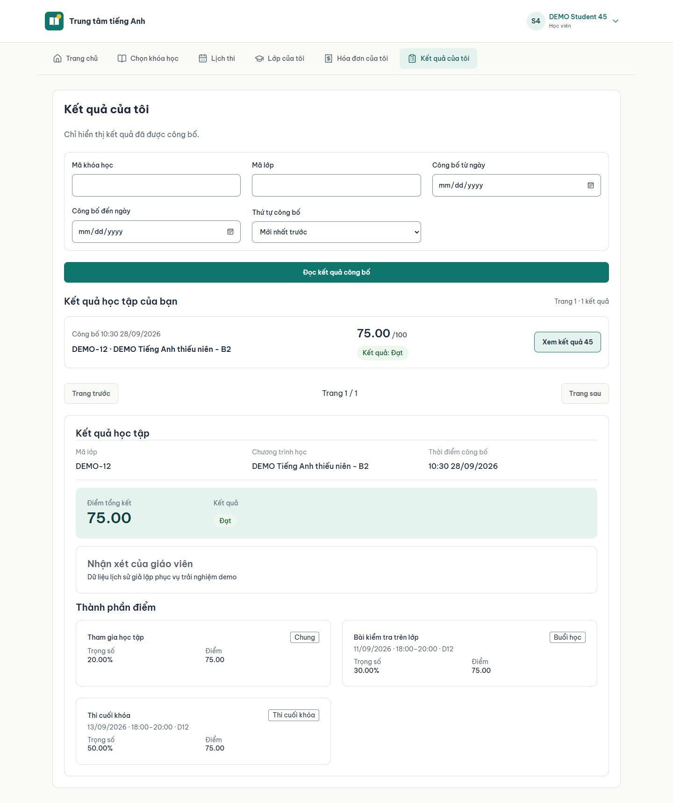

| STT | Loại | Ý nghĩa | Biến cố/Xử lý |
|---|---|---|---|
| 1 | TextBox | “Mã khóa học”, “Mã lớp”. | Nhập tiêu chí giới hạn kết quả của chính học viên; chờ đọc lại. |
| 2 | DatePicker | “Công bố từ ngày”, “Công bố đến ngày”. | Chọn khoảng thời điểm công bố để lọc kết quả. |
| 3 | ComboBox | “Thứ tự công bố”. | Chọn mới nhất hoặc cũ nhất trước cho lần truy vấn tiếp theo. |
| 4 | Button | “Đọc kết quả công bố”. | Click đọc danh sách báo cáo đã công bố theo bộ lọc; không đọc bảng điểm nháp. |
| 5 | Card, Badge | Thẻ kết quả: lớp, chương trình, thời điểm công bố, tổng điểm và Đạt/Chưa đạt. | Chỉ hiển thị kết quả được công bố của học viên. |
| 6 | Button | “Xem kết quả [mã]”. | Click đọc chi tiết và mở phần kết quả ngay trong GD10. |
| 7 | Label | Chi tiết điểm tổng kết, nhận xét giáo viên, tên/loại/trọng số/điểm của từng thành phần. | Chỉ đọc; không có điều khiển sửa điểm hay gửi lại bảng điểm. |
| 8 | Button | “Trang trước”, “Trang sau”. | Click đọc trang kết quả trước/sau. |

## GD11. Tra cứu hồ sơ tuyển sinh

**Vai trò:** Nhân viên tuyển sinh. **Mã liên quan:** F13.

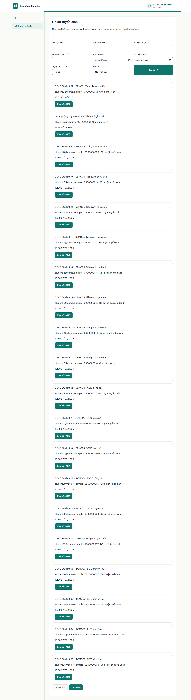

| STT | Loại | Ý nghĩa | Biến cố/Xử lý |
|---|---|---|---|
| 1 | TextBox | “Tên học viên”, “Email học viên”, “Số điện thoại”. | Nhập các tiêu chí riêng để tìm hồ sơ; nhập chữ không tự lọc danh sách. |
| 2 | TextBox | “Mã định danh khóa”. | Nhập mã khóa để giới hạn hồ sơ cần tra cứu. |
| 3 | DatePicker | “Tạo từ ngày”, “Tạo đến ngày”. | Chọn khoảng ngày tạo hồ sơ cần tìm. |
| 4 | ComboBox | “Trạng thái hồ sơ”. | Chọn một trạng thái hoặc Tất cả; tiêu chí được áp dụng khi bấm tìm. |
| 5 | ComboBox | “Thứ tự”. | Chọn mới nhất hoặc cũ nhất trước. |
| 6 | Button | “Tìm hồ sơ”. | Click truy vấn danh sách theo toàn bộ bộ lọc hiện tại. |
| 7 | Card | Dòng hồ sơ: học viên, liên hệ, khóa, trạng thái và ngày đăng ký. | Hiển thị thông tin được phép dùng cho tuyển sinh; không cho sửa hồ sơ cá nhân hoặc điểm. |
| 8 | Button | “Xem hồ sơ [mã]”. | Click đọc chi tiết GD12 trong cùng trang hồ sơ tuyển sinh. |
| 9 | Button | “Trang trước”, “Trang sau”. | Click đọc trang kết quả tìm kiếm trước/sau. |

## GD12. Chi tiết và xét duyệt hồ sơ tuyển sinh

**Vai trò:** Nhân viên tuyển sinh. **Mã liên quan:** F14.

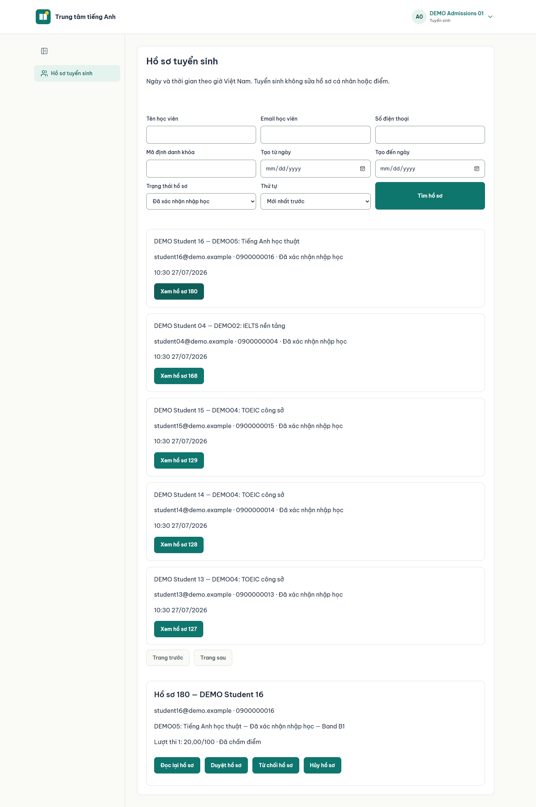

Ảnh bổ sung: [Xem trước duyệt hồ sơ](images/106.png).

| STT | Loại | Ý nghĩa | Biến cố/Xử lý |
|---|---|---|---|
| 1 | Label | Học viên, liên hệ, khóa học, trạng thái hồ sơ và Band. | Hiển thị chi tiết hồ sơ vừa chọn từ GD11; không mở biểu mẫu sửa thông tin học viên. |
| 2 | Label | Kết quả các lượt thi, hóa đơn và lý do từ chối/hủy nếu có. | Chỉ đọc các dữ kiện phục vụ xét duyệt. |
| 3 | Button | “Đọc lại hồ sơ”. | Click đọc mới dữ liệu của hồ sơ hiện tại. |
| 4 | Button | “Duyệt hồ sơ”. | Click đọc điều kiện duyệt và học phí hiện tại, mở phần xem trước trên GD12; chưa duyệt ngay. |
| 5 | Button | “Chuẩn bị duyệt”, trong phần xem trước hợp lệ. | Click mở hộp thoại xác nhận duyệt; tóm tắt việc phát hành hóa đơn chưa thanh toán, không tự xếp lớp. |
| 6 | Button | “Từ chối hồ sơ”. | Click mở phần nhập lý do từ chối. |
| 7 | Button | “Hủy hồ sơ”. | Click đọc tác động hủy, thể hiện lượt đặt tương lai/hóa đơn có liên quan; chỉ mở phần nhập lý do khi được phép. |
| 8 | TextArea | Ô lý do, trong biểu mẫu từ chối/hủy. | Nhập nội dung giải thích; chưa lưu cho tới bước xác nhận. |
| 9 | Button | “Chuẩn bị xác nhận”, trong biểu mẫu lý do. | Click kiểm tra lý do và mở hộp thoại xác nhận thao tác. |
| 10 | Button | “Xác nhận thao tác”, trong hộp thoại cuối cùng. | Click gửi duyệt/từ chối/hủy theo ý định đang xem; máy chủ kiểm tra lại điều kiện trước khi cập nhật hồ sơ và dữ liệu liên quan. |
| 11 | Button | “Hủy” trong biểu mẫu hoặc “Đóng” hộp thoại. | Click bỏ bản nhập/ý định hiện tại; khác với nút “Hủy hồ sơ”, không tự hủy hồ sơ nghiệp vụ. |
| 12 | Label | Lý do thao tác bị khóa. | Hiển thị điều kiện chưa đạt để người dùng biết vì sao không thể duyệt/từ chối/hủy. |

## GD13. Quản lý ca kiểm tra đầu vào

**Vai trò:** Giáo vụ. **Mã liên quan:** F16, F17.

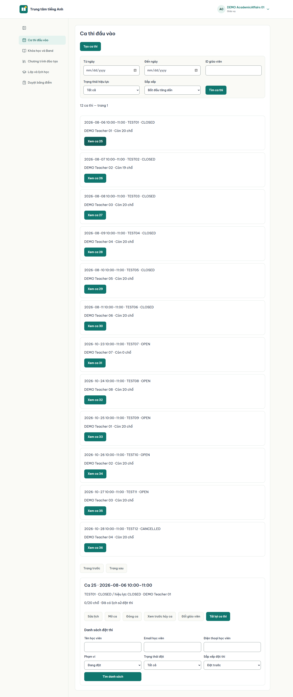

Ảnh bổ sung: [Tạo ca thi](images/026.png), [Danh sách đặt thi](images/091.png).

| STT | Loại | Ý nghĩa | Biến cố/Xử lý |
|---|---|---|---|
| 1 | DatePicker, TextBox | Bộ lọc “Từ ngày”, “Đến ngày”, “ID giáo viên”. | Nhập phạm vi thời gian và giáo viên của ca cần tìm; chờ bấm tìm. |
| 2 | ComboBox | “Trạng thái hiệu lực”, “Sắp xếp”. | Chọn tiêu chí trạng thái và thứ tự thời gian cho lần tìm tiếp theo. |
| 3 | Button | “Tìm ca thi”. | Click truy vấn danh sách ca theo bộ lọc. |
| 4 | Button | “Xem ca [mã]”. | Click mở chi tiết ca, giáo viên, sức chứa và phần danh sách đặt thi ngay trong GD13. |
| 5 | Button | “Tạo ca thi”. | Click mở biểu mẫu tạo ca ở trạng thái đóng. |
| 6 | DatePicker, TimePicker, TextBox, NumberBox | Các ô ngày thi, bắt đầu, kết thúc, phòng và sức chứa trong biểu mẫu tạo. | Nhập thông tin ca; sức chứa nhập số nguyên từ 1 đến 20. Thay cửa sổ ngày giờ cần xem lại giáo viên phù hợp. |
| 7 | Button, ComboBox | “Xem giáo viên phù hợp” và ô “Giáo viên chấm” trong biểu mẫu. | Click đọc các giáo viên phù hợp với ngày giờ; chọn một giáo viên từ danh sách, chưa lưu ca. |
| 8 | Button | “Lưu”, “Hủy” trong biểu mẫu. | “Lưu” kiểm tra và gửi tạo/sửa ca; “Hủy” đóng biểu mẫu, không hủy ca đã có. |
| 9 | Button | “Sửa lịch”. | Click mở biểu mẫu sửa ngày giờ/phòng của ca khi trạng thái cho phép. |
| 10 | Button | “Mở ca”, “Đóng ca”. | Click mở hộp thoại xác nhận; chỉ cập nhật trạng thái sau khi bấm xác nhận trong hộp thoại. |
| 11 | Button | “Đổi giáo viên”, “Xem trước hủy ca”. | Click lần lượt mở lựa chọn giáo viên mới hoặc đọc tác động hủy; xem trước và nhập lý do trước bước xác nhận cuối. |
| 12 | TextBox, ComboBox | Bộ lọc học viên và phạm vi/trạng thái đặt trong phần danh sách đặt thi. | Nhập/chọn tiêu chí của lượt đặt thuộc ca đang xem. |
| 13 | Button | “Tìm danh sách”. | Click đọc danh sách lượt đặt của ca, gồm học viên, lượt thi và dữ liệu theo quyền giáo vụ. |
| 14 | Button | Các nút chuyển trang ca/giáo viên/danh sách đặt thi và “Tải lại ca thi”. | Click đọc trang hoặc dữ liệu tương ứng; không chuyển trang của danh sách khác. |

## GD14. Quản lý khóa học và tra cứu Band

**Vai trò:** Giáo vụ. **Mã liên quan:** Phần khóa học/Band của F18.

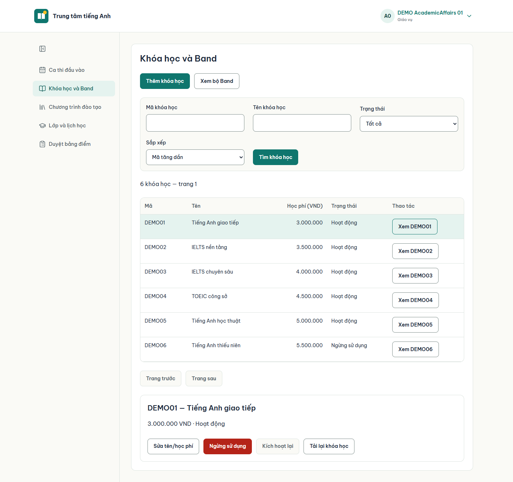

Ảnh bổ sung: [Bộ Band](images/030.png), [Tạo khóa](images/029.png), [Sửa tên và học phí](images/108.png).

| STT | Loại | Ý nghĩa | Biến cố/Xử lý |
|---|---|---|---|
| 1 | TextBox | “Mã khóa học”, “Tên khóa học”. | Nhập tiêu chí tìm khóa, chưa truy vấn khi gõ. |
| 2 | ComboBox | “Trạng thái”, “Sắp xếp”. | Chọn trạng thái sử dụng và thứ tự mã khóa cho lần tìm tiếp theo. |
| 3 | Button | “Tìm khóa học”. | Click truy vấn danh sách khóa học theo bộ lọc. |
| 4 | Table | Danh sách mã, tên, học phí, trạng thái và thao tác. | Hiển thị kết quả tìm; các ô trong bảng không phải ô nhập sửa trực tiếp. |
| 5 | Button | “Xem [mã khóa]”. | Click đọc chi tiết khóa và mở phần thông tin bên dưới GD14. |
| 6 | Button | “Thêm khóa học”. | Click mở hộp thoại tạo khóa mới. |
| 7 | Button | “Sửa tên/học phí”. | Click mở hộp thoại sửa tên và học phí của khóa được chọn. |
| 8 | TextBox | Mã khóa, tên và học phí trong biểu mẫu tạo/sửa. | Nhập dữ liệu; mã khóa không phải trường được thay trong thao tác sửa tên/học phí. |
| 9 | Button | Nút lưu và “Hủy” trong biểu mẫu khóa học. | Lưu kiểm tra và gửi tạo/cập nhật; Hủy đóng biểu mẫu, không thay dữ liệu khóa. |
| 10 | Button | “Ngừng sử dụng”, “Kích hoạt lại”. | Click mở hộp thoại xác nhận thay đổi trạng thái; xác nhận mới gửi lệnh. Ngừng khóa chỉ chặn đăng ký mới, không xóa hồ sơ/lớp hiện có. |
| 11 | Button | “Xem bộ Band”. | Click đọc và hiển thị danh sách ngưỡng Band tham chiếu ngay trên GD14. |
| 12 | Label | Mã Band, điểm tối thiểu và trạng thái đóng băng ngưỡng. | Chỉ đọc; UI không có thao tác tự sửa ngưỡng ở phần này. |
| 13 | Button | “Tải lại khóa học”, “Trang trước”, “Trang sau”. | Click đọc mới khóa đang xem hoặc trang danh sách trước/sau. |

## GD15. Quản lý chương trình đào tạo

**Vai trò:** Giáo vụ. **Mã liên quan:** Phần chương trình/thành phần điểm của F18.

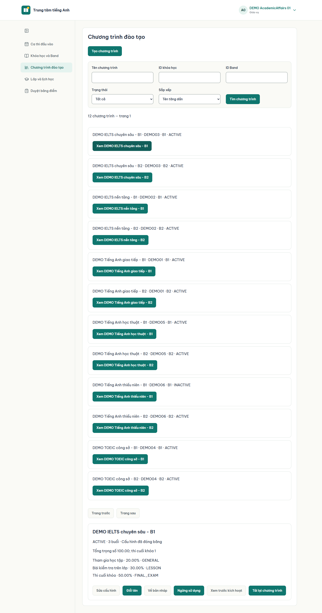

Ảnh bổ sung: [Tạo bản nháp](images/033.png), [Đổi tên](images/035.png).

| STT | Loại | Ý nghĩa | Biến cố/Xử lý |
|---|---|---|---|
| 1 | TextBox | Tên chương trình, ID khóa học và ID Band trong bộ lọc. | Nhập tiêu chí tìm chương trình; chờ bấm tìm. |
| 2 | ComboBox | “Trạng thái”, “Sắp xếp”. | Chọn bản nháp/đang sử dụng/ngừng sử dụng và thứ tự tên. |
| 3 | Button | “Tìm chương trình”. | Click đọc danh sách chương trình theo bộ lọc. |
| 4 | Button | “Xem [tên chương trình]”. | Click đọc chi tiết và mở thông tin chương trình ngay trong GD15. |
| 5 | Label | Khóa, Band, số buổi, trạng thái, đóng băng cấu hình, thành phần điểm và tổng trọng số. | Chỉ đọc cấu hình đã lưu và các vấn đề kiểm tra hiện có. |
| 6 | Button | “Tạo chương trình”. | Click mở hộp thoại “Tạo bản nháp”. |
| 7 | TextBox, NumberBox | Tên chương trình, số buổi và ID khóa học tham chiếu trong biểu mẫu. | Nhập thông tin bản nháp; ID khóa phải được đọc để đối chiếu trước khi lưu. |
| 8 | Button | “Đọc khóa học”, “Đọc bộ Band”, trong biểu mẫu. | Click đọc thông tin khóa hoặc bộ Band để chọn tham chiếu hợp lệ. |
| 9 | ComboBox | Band và loại thành phần điểm trong biểu mẫu. | Chọn Band; chọn loại thành phần Chung/Buổi học/Thi cuối khóa tương ứng. |
| 10 | TextBox, Button | Tên, trọng số của từng thành phần và các nút “Thêm thành phần”, “Xóa [thứ tự]”. | Nhập tên/trọng số; Click thêm/xóa thay đổi danh sách thành phần trong bản nhập, chưa sửa chương trình trên máy chủ. |
| 11 | Button | “Sửa cấu hình”. | Click mở biểu mẫu sửa toàn bộ cấu hình khi quyền và trạng thái cho phép; nút bị khóa với cấu hình đã đóng băng. |
| 12 | Button | “Lưu bản nháp”, “Hủy” trong biểu mẫu. | Lưu kiểm tra và gửi bản nháp; Hủy bỏ bản nhập hiện tại. |
| 13 | Button | “Đổi tên”, “Về bản nháp”, “Ngừng sử dụng”. | Click mở hộp thoại thao tác tương ứng; đổi tên nhập tên mới, rồi xác nhận mới gửi thay đổi. |
| 14 | Button | “Xem trước kích hoạt”. | Click kiểm tra cấu hình đã lưu và mở hộp thoại kết quả; “Xác nhận kích hoạt” chỉ được gửi khi cấu hình đủ điều kiện. |
| 15 | Button | “Tải lại chương trình” và các nút chuyển trang. | Click đọc mới chương trình hoặc danh sách trang trước/sau. |

## GD16. Quản lý lớp và lập lịch học

**Vai trò:** Giáo vụ. **Mã liên quan:** F19, F20, F21.

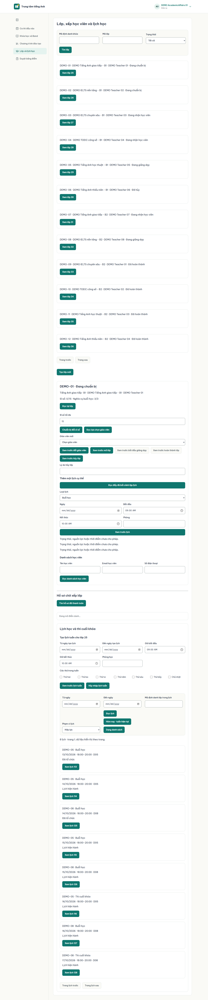

Ảnh bổ sung: [Tạo lớp](images/037.png), [Chi tiết lớp](images/038.png).

| STT | Loại | Ý nghĩa | Biến cố/Xử lý |
|---|---|---|---|
| 1 | TextBox, ComboBox | Mã định danh khóa, mã lớp và trạng thái trong bộ lọc lớp. | Nhập/chọn tiêu chí; bấm “Tìm lớp” để đọc danh sách phù hợp. |
| 2 | Button | “Xem lớp [mã]”. | Click mở chi tiết lớp và các phần điều chỉnh, học viên, lịch ngay trên GD16. |
| 3 | Button | “Tạo lớp mới”. | Click mở biểu mẫu tạo lớp. “Đọc chương trình đang dùng” và “Đọc giáo viên” lấy dữ liệu để chọn chương trình/giáo viên. |
| 4 | TextBox, ComboBox | Mã lớp, chương trình, giáo viên, sĩ số tối đa trong biểu mẫu tạo. | Nhập/chọn thông tin lớp; “Chuẩn bị tạo lớp” mở hộp thoại và xác nhận sau đó mới tạo lớp. |
| 5 | Label | Trạng thái, chương trình, Band, giáo viên, sĩ số và tiến độ nghĩa vụ buổi học. | Chỉ đọc dữ liệu lớp hiện tại; không tự tính hoàn thành chỉ từ thời gian đã trôi qua. |
| 6 | TextBox, Button | “Sĩ số tối đa” và “Chuẩn bị đổi sĩ số”. | Nhập sĩ số mới rồi Click chuẩn bị để mở hộp thoại xác nhận thay đổi hợp lệ. |
| 7 | Button, ComboBox | “Đọc lựa chọn giáo viên” và “Giáo viên mới”. | Click đọc lựa chọn phù hợp, rồi chọn giáo viên mới; chưa đổi phân công khi chỉ chọn. |
| 8 | Button | Các nút “Xem trước…” đổi giáo viên, mở/bắt đầu/hoàn tất/hủy lớp. | Click đọc điều kiện và tác động; chỉ cho chuẩn bị xác nhận nếu thao tác được phép. Hủy lớp có phần nhập lý do. |
| 9 | ComboBox, DatePicker, TimePicker, TextBox | Loại lịch, ngày, giờ bắt đầu/kết thúc và phòng của một lịch cụ thể. | Nhập buổi học hoặc thi cuối khóa cần thêm cho lớp, chưa tạo lịch. |
| 10 | Button | “Đọc đầy đủ bối cảnh lập lịch”, “Xem trước lịch”. | Click lần lượt đọc bối cảnh lớp hoặc kiểm tra lịch định thêm; hiển thị kết quả đủ điều kiện/xung đột. |
| 11 | DatePicker, TimePicker, TextBox, CheckBox | Khoảng ngày, thứ trong tuần, giờ và phòng trong phần tạo lịch tuần. | Nhập quy tắc tuần; sửa thông tin làm mất hiệu lực kết quả xem trước cũ. |
| 12 | Button | “Xem trước lịch tuần”, “Hủy nhập lịch tuần”. | Click lần lượt kiểm tra toàn bộ các buổi dự kiến hoặc bỏ quy tắc đang nhập; không tự tạo một phần lịch. |
| 13 | Button | “Chuẩn bị tạo toàn bộ tuần”, khi kết quả xem trước hợp lệ. | Click mở hộp thoại xác nhận toàn bộ lịch đã xem. |
| 14 | Button | “Xác nhận thao tác” hoặc “Xác nhận lịch”, trong hộp thoại tương ứng. | Click gửi đúng thay đổi lớp/lịch đang xác nhận; máy chủ kiểm tra lại dữ liệu và xung đột trước khi lưu. |
| 15 | Button | “Đọc danh sách học viên”, sau các ô tên/email/điện thoại. | Click đọc danh sách học viên thuộc lớp đang xem; kết quả chỉ hiển thị theo quyền giáo vụ. |
| 16 | Button | “Đọc lịch”, “Hôm nay · tuần hiện tại”, “Dạng danh sách”, “Xem lịch [mã]”. | Tương tác xem lịch như GD09; giáo vụ có thêm thao tác xem trước đổi lịch, thay thế buổi không tổ chức và xác nhận buổi đã tổ chức khi chọn buổi đủ điều kiện. |

## GD17. Xếp học viên vào lớp phù hợp

**Vai trò:** Giáo vụ. **Mã liên quan:** F22.

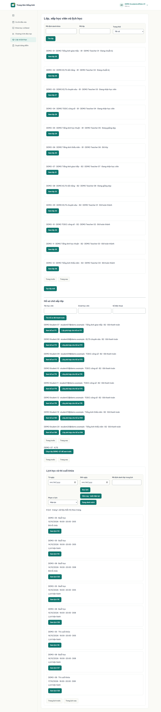

Ảnh bổ sung: [Hồ sơ chờ xếp lớp](images/089.png).

| STT | Loại | Ý nghĩa | Biến cố/Xử lý |
|---|---|---|---|
| 1 | TextBox | Tên học viên, email, số điện thoại trong phần hồ sơ chờ xếp lớp. | Nhập tiêu chí tìm hồ sơ đủ điều kiện, chưa tự truy vấn. |
| 2 | Button | “Tìm hồ sơ đã thanh toán”. | Click đọc các hồ sơ đã thanh toán đang chờ xếp lớp. |
| 3 | Card | Thông tin học viên, khóa, Band và trạng thái đã thanh toán. | Chỉ đọc dữ liệu hồ sơ ứng viên; không có bước ghi nhận thanh toán tại đây. |
| 4 | Button | “Xem hồ sơ [mã]” trong danh sách chờ xếp lớp. | Click đọc hồ sơ ứng viên để đối chiếu ngay trong GD17; không chuyển sang quyền tuyển sinh GD12. |
| 5 | Button | “Lớp phù hợp cho hồ sơ [mã]”. | Click đọc các lớp có thể xếp cho đúng hồ sơ và các lý do chặn nếu có. |
| 6 | Card | Lớp phù hợp: mã lớp, sĩ số và các điều kiện chưa đạt. | Chỉ đọc để lựa chọn; không giữ chỗ khi mở danh sách. |
| 7 | Button | “Chọn lớp [mã] để xem trước”. | Click đọc chi tiết lớp đã chọn và giữ hồ sơ ứng viên để chuẩn bị xếp. |
| 8 | Button | “Xem trước xếp học viên vào lớp này”. | Click kiểm tra việc xếp hồ sơ đang chọn vào lớp; hiển thị kết quả và tác động. |
| 9 | Button | “Chuẩn bị xác nhận”, sau xem trước hợp lệ. | Click mở hộp thoại xác nhận xếp lớp. |
| 10 | Button | “Xác nhận thao tác”, trong hộp thoại. | Click gửi xếp học viên; hệ thống kiểm tra lại thanh toán, Band, trạng thái, chỗ trống và xung đột trước khi lưu. |
| 11 | Label | “Đang chờ lớp phù hợp” hoặc lý do không thể chọn lớp. | Hiển thị khi chưa có lựa chọn phù hợp; không tự tạo lớp hoặc tự ép xếp lớp. |
| 12 | Button | Các nút chuyển trang hồ sơ hoặc lớp phù hợp. | Click đọc trang trước/sau của đúng danh sách đang xem. |

## GD18. Duyệt và công bố bảng điểm

**Vai trò:** Giáo vụ. **Mã liên quan:** F23.

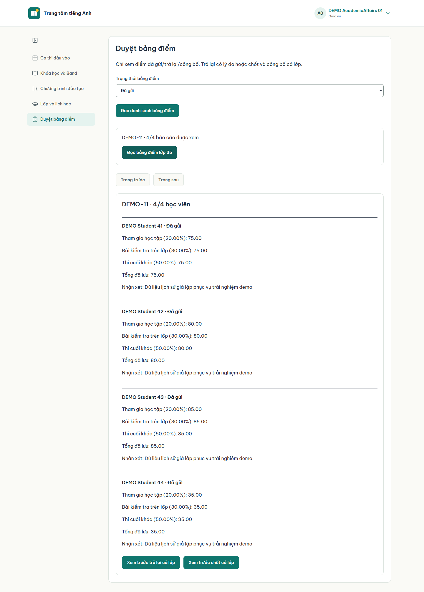

Ảnh bổ sung: [Trả lại](images/087.png), [Chốt và công bố](images/088.png).

| STT | Loại | Ý nghĩa | Biến cố/Xử lý |
|---|---|---|---|
| 1 | ComboBox | “Trạng thái bảng điểm”: Đã gửi, Đã trả lại, Đã công bố. | Chọn trạng thái làm xóa danh sách/chi tiết cũ; cần đọc lại. |
| 2 | Button | “Đọc danh sách bảng điểm”. | Click đọc các lớp/bảng điểm thuộc trạng thái đã chọn; không mở điểm nháp của giáo viên. |
| 3 | Button | “Đọc bảng điểm lớp [mã]”. | Click mở chi tiết điểm của lớp ngay trong GD18. |
| 4 | Label | Mã lớp, số báo cáo được xem/sĩ số, điểm thành phần, tổng và nhận xét từng học viên. | Chỉ đọc dữ liệu được phép duyệt; giáo vụ không nhập sửa trực tiếp điểm của giáo viên. |
| 5 | Button | “Xem trước trả lại cả lớp”. | Click kiểm tra và mở hộp thoại trả lại cả lớp nếu hợp lệ. |
| 6 | TextArea | “Lý do trả lại”, trong hộp thoại trả lại. | Nhập lý do bắt buộc, chưa gửi trả lại. |
| 7 | Button | “Xác nhận trả lại cả lớp”, trong hộp thoại. | Click trả lại toàn bộ bảng điểm của lớp; giữ điểm/nhận xét đã lưu và cho giáo viên sửa, gửi lại theo quyền. |
| 8 | Button | “Xem trước chốt cả lớp”. | Click kiểm tra và mở hộp thoại chốt/công bố toàn lớp. |
| 9 | Button | “Xác nhận chốt cả lớp”, trong hộp thoại. | Click chốt và công bố đồng thời kết quả hợp lệ của cả lớp; học viên xem tại GD10, điểm/nhận xét đã chốt không được sửa. |
| 10 | Button | “Đóng” hoặc nút đóng xem trước. | Click đóng ý định đang xem, không trả lại hoặc công bố điểm. |
| 11 | Button | “Trang trước”, “Trang sau”. | Click đọc trang danh sách lớp trước/sau. |

## GD19. Lớp và lịch dạy của giáo viên

**Vai trò:** Giáo viên. **Mã liên quan:** F24.

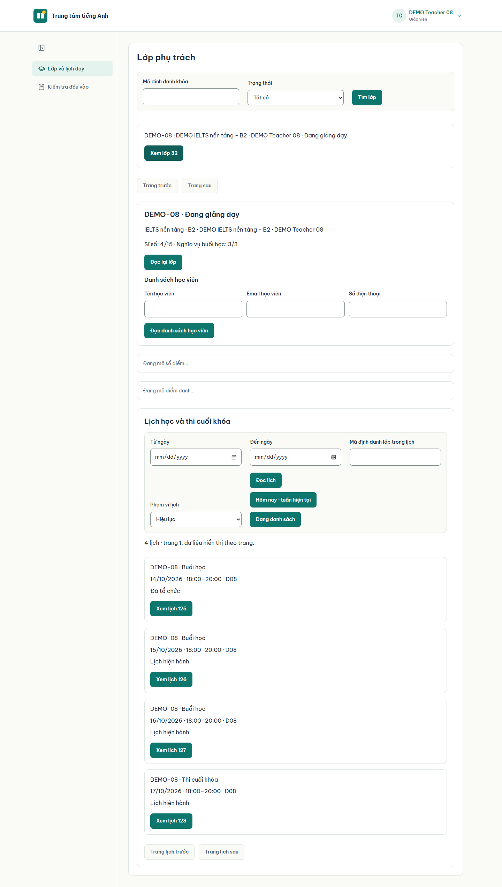

Ảnh bổ sung: [Danh sách học viên lớp](images/046.png).

| STT | Loại | Ý nghĩa | Biến cố/Xử lý |
|---|---|---|---|
| 1 | TextBox, ComboBox | Mã định danh khóa và trạng thái lớp. | Nhập/chọn tiêu chí tìm các lớp được phân công; chờ bấm tìm. |
| 2 | Button | “Tìm lớp”. | Click đọc danh sách lớp trong phạm vi giáo viên hiện tại. |
| 3 | Button | “Xem lớp [mã]”. | Click mở chi tiết lớp, danh sách học viên, điểm danh, sổ điểm và lịch tương ứng ngay trong trang lớp. |
| 4 | Label | Mã lớp, chương trình, Band, sĩ số và nghĩa vụ buổi học. | Chỉ đọc thông tin phân công; giáo viên không sửa sĩ số hoặc tự đổi giáo viên của lớp. |
| 5 | TextBox | Tên học viên, email, số điện thoại trong phần danh sách học viên. | Nhập tiêu chí tìm học viên thuộc lớp. |
| 6 | Button | “Đọc danh sách học viên”. | Click đọc danh sách học viên theo lớp và bộ lọc đang nhập. |
| 7 | Button | “Đọc danh sách điểm danh”, “Đọc điểm danh buổi [mã]”. | Click đọc phần điểm danh GD21 trong khu vực lớp hiện tại; có thể mở trực tiếp đường dẫn điểm danh lớp/buổi đã hỗ trợ. |
| 8 | Button | “Đọc sổ điểm”, “Điểm học viên [mã]”. | Click đọc bảng điểm rồi chi tiết học viên GD22 trong khu vực lớp; không tự nhập điểm khi mở. |
| 9 | Button | Các nút đọc lịch, xem tuần/danh sách và xem lịch buổi. | Click xem lịch dạy/buổi thi cuối khóa của lớp được phân công; không cho giáo viên tự điều chỉnh lịch của giáo vụ. |
| 10 | Button | “Đọc lại lớp” và các nút chuyển trang. | Click đọc mới chi tiết hoặc trang danh sách tương ứng. |

## GD20. Nhiệm vụ và chấm kiểm tra đầu vào

**Vai trò:** Giáo viên được phân công chấm. **Mã liên quan:** F25.

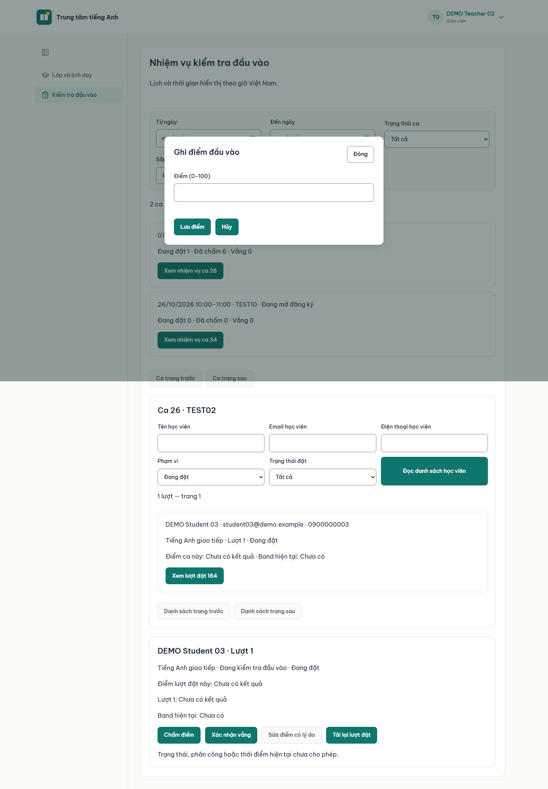

Ảnh bổ sung: [Chi tiết lượt đặt và nhiệm vụ](images/077.png).

| STT | Loại | Ý nghĩa | Biến cố/Xử lý |
|---|---|---|---|
| 1 | DatePicker, ComboBox | Khoảng ngày, trạng thái ca và sắp xếp ca. | Nhập/chọn bộ lọc cho các ca được phân công. |
| 2 | Button | “Đọc ca được phân công”. | Click đọc các ca thi trong phạm vi giáo viên hiện tại. |
| 3 | Button | “Xem nhiệm vụ ca [mã]”. | Click chọn ca và mở phần tìm danh sách học viên ngay trên GD20. |
| 4 | TextBox, ComboBox | Tên/email/điện thoại, phạm vi và trạng thái đặt trong phần học viên. | Nhập/chọn tiêu chí của lượt đặt trong ca; chưa đọc khi chỉ thay bộ lọc. |
| 5 | Button | “Đọc danh sách học viên”. | Click đọc các lượt đặt và thông tin nhiệm vụ thuộc ca. |
| 6 | Button | “Xem lượt đặt [mã]”. | Click đọc chi tiết học viên, lượt thi, điểm, Band và các thao tác được phép. |
| 7 | Button | “Chấm điểm”. | Click mở hộp thoại “Ghi điểm đầu vào”. |
| 8 | TextBox | “Điểm (0–100)” trong hộp thoại. | Nhập điểm theo thang 100; không tự lưu khi nhập. |
| 9 | Button | “Lưu điểm”. | Click kiểm tra và gửi điểm cho lượt đặt được chọn; thành công cập nhật kết quả và Band theo quy tắc hệ thống. |
| 10 | Button | “Sửa điểm có lý do”. | Click mở hộp thoại sửa khi đủ quyền/điều kiện; phải nhập điểm và lý do rồi bấm “Sửa điểm”. |
| 11 | Button | “Xác nhận vắng”, tại chi tiết và trong hộp thoại tương ứng. | Nút tại chi tiết mở hộp thoại; nút xác nhận bên trong mới gửi ghi nhận vắng. Vắng không được quy thành điểm 0 và không làm tăng lượt thi hoàn tất. |
| 12 | Button | “Hủy” hoặc “Đóng” hộp thoại. | Click đóng biểu mẫu điểm/vắng, không hủy lượt đặt nghiệp vụ. |
| 13 | Button | “Tải lại lượt đặt” và các nút chuyển trang ca/danh sách. | Click đọc lại lượt đặt hoặc trang tương ứng. |

## GD21. Điểm danh buổi học

**Vai trò:** Giáo viên phụ trách; giáo vụ chỉ xem trong phần được cấp quyền. **Mã liên quan:** F26.

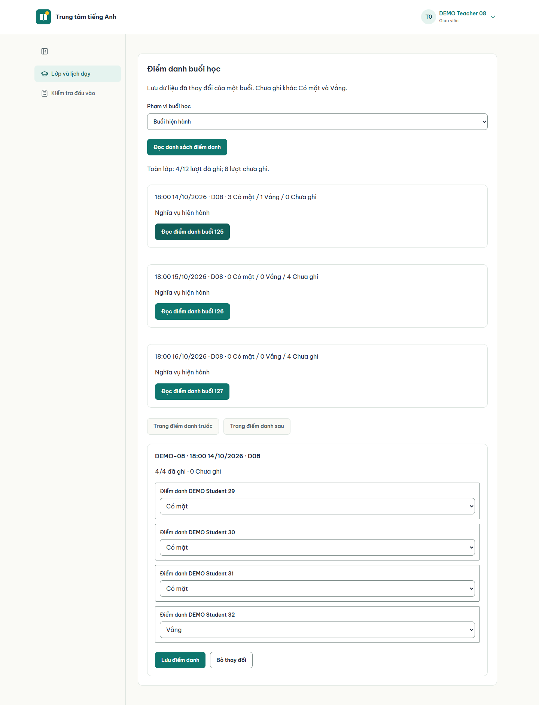

| STT | Loại | Ý nghĩa | Biến cố/Xử lý |
|---|---|---|---|
| 1 | ComboBox | “Phạm vi buổi học”: Buổi hiện hành hoặc Toàn bộ lịch sử. | Chọn phạm vi xóa danh sách/phiếu cũ; cần đọc lại danh sách. |
| 2 | Button | “Đọc danh sách điểm danh”. | Click đọc các buổi và số liệu điểm danh của lớp đang xem. |
| 3 | Card | Mỗi buổi: thời gian, phòng, số có mặt/vắng/chưa ghi và nghĩa vụ hiện hành/lịch sử. | Chỉ đọc để chọn đúng buổi điểm danh. |
| 4 | Button | “Đọc điểm danh buổi [mã]”. | Click mở phiếu điểm danh của buổi ngay trong GD21. |
| 5 | ComboBox | Trạng thái điểm danh của từng học viên. | Chọn Có mặt hoặc Vắng để thay đổi bản nhập; Chưa ghi không tự được tính là Có mặt hay điểm 0. |
| 6 | Button | “Lưu điểm danh”. | Click gửi các thay đổi của phiếu buổi đang chọn; chỉ cho giáo viên phụ trách lưu khi buổi và dữ liệu đủ điều kiện. |
| 7 | Button | “Bỏ thay đổi”. | Click bỏ các lựa chọn chưa lưu và trở về dữ liệu đã đọc. |
| 8 | Label | Tổng toàn lớp, số đã ghi/chưa ghi của buổi và lý do chỉ được xem. | Hiển thị số liệu và quyền chỉnh sửa; trong chế độ chỉ xem không xuất hiện điều khiển ghi điểm danh. |
| 9 | Button | “Trang điểm danh trước”, “Trang điểm danh sau”. | Click đọc trang buổi trước/sau; khi đang có thay đổi chưa lưu phải xử lý bản nhập trước. |

## GD22. Sổ điểm và nhập điểm thành phần

**Vai trò:** Giáo viên phụ trách. **Mã liên quan:** F27.

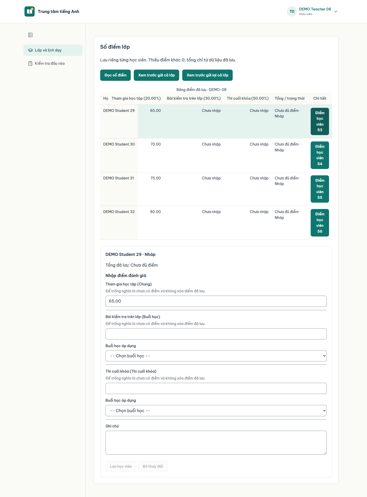

Ảnh bổ sung: [Sổ điểm đã lưu](images/080.png).

| STT | Loại | Ý nghĩa | Biến cố/Xử lý |
|---|---|---|---|
| 1 | Button | “Đọc sổ điểm”. | Click đọc điểm đã lưu của lớp; không tự tính dữ liệu chưa lưu thành kết quả chính thức. |
| 2 | Table | Bảng học viên, điểm theo thành phần, tổng và trạng thái báo cáo. | Hiển thị dữ liệu đã lưu; ô bảng không phải ô nhập trực tiếp. |
| 3 | Button | “Điểm học viên [mã]”. | Click đọc chi tiết và mở biểu mẫu nhập điểm/nhận xét cho một học viên. |
| 4 | TextBox | Ô điểm cho từng thành phần Chung/Buổi học/Thi cuối khóa. | Nhập điểm vào bản nháp; thiếu điểm khác với điểm 0. |
| 5 | ComboBox | Lựa chọn buổi học hoặc buổi thi liên kết với thành phần cần lịch. | Chọn lịch hợp lệ sau khi đọc các lựa chọn tương ứng; chưa lưu liên kết khi chỉ chọn. |
| 6 | TextArea | Ô nhận xét của giáo viên. | Nhập nhận xét cho học viên đang mở. |
| 7 | Button | “Lưu học viên”. | Click lưu đồng thời các thay đổi hợp lệ về điểm, liên kết lịch và nhận xét của đúng học viên đang mở; không gửi cả lớp. |
| 8 | Button | “Bỏ thay đổi”. | Click bỏ bản nhập điểm/nhận xét chưa lưu. |
| 9 | Button | “Xem trước gửi cả lớp”, “Xem trước gửi lại cả lớp”. | Click kiểm tra toàn bộ dữ liệu đã lưu của lớp; mở kết quả xem trước và hộp thoại nếu đủ điều kiện. Có bản nhập chưa lưu thì phải xử lý trước. |
| 10 | Button | “Xác nhận gửi cả lớp”, trong hộp thoại. | Click gửi/gửi lại toàn bộ bảng điểm để giáo vụ duyệt ở GD18; chưa công bố cho học viên. |
| 11 | Button | “Đóng xem trước điểm” hoặc “Đóng” hộp thoại. | Click đóng bước xem trước, không gửi bảng điểm. |
| 12 | Label | Lý do chưa đủ điều kiện, thành phần thiếu hoặc trạng thái bảng điểm. | Hiển thị vấn đề cần xử lý; kết quả chỉ xuất hiện ở GD10 sau khi giáo vụ chốt/công bố. |

## GD23. Hóa đơn và xác nhận thanh toán

**Vai trò:** Kế toán. **Mã liên quan:** F28, F29.

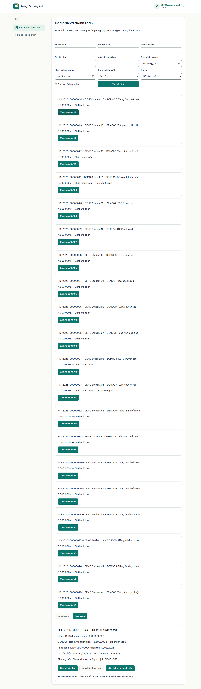

Ảnh bổ sung: [Đối chiếu thu đủ](images/109.png), [Sửa thông tin thanh toán](images/054.png).

| STT | Loại | Ý nghĩa | Biến cố/Xử lý |
|---|---|---|---|
| 1 | TextBox | Số hóa đơn, tên/email/điện thoại học viên và mã định danh khóa. | Nhập tiêu chí tra cứu; chưa tự truy vấn khi nhập. |
| 2 | DatePicker | “Phát hành từ ngày”, “Phát hành đến ngày”. | Chọn khoảng ngày phát hành hóa đơn cần tìm. |
| 3 | ComboBox | Trạng thái hóa đơn và thứ tự. | Chọn trạng thái/thứ tự cho lần tìm tiếp theo. |
| 4 | CheckBox | “Chỉ hóa đơn quá hạn”. | Đánh dấu để giới hạn kết quả khi bấm tìm; không tự hủy khoản nợ. |
| 5 | Button | “Tìm hóa đơn”. | Click đọc danh sách hóa đơn theo toàn bộ bộ lọc. |
| 6 | Button | “Xem hóa đơn [mã]”. | Click mở chi tiết hóa đơn và dữ liệu thanh toán liên quan ngay trong GD23. |
| 7 | Label | Học viên, khóa, số tiền, hạn thu, trạng thái; người xác nhận/phương thức/mã giao dịch nếu đã thu. | Chỉ đọc để đối chiếu giao dịch bên ngoài; không sửa số tiền bằng phần nhập thanh toán. |
| 8 | Button | “Xác nhận thanh toán”. | Click đọc điều kiện thu đủ và mở phần đối chiếu; chưa chuyển hóa đơn sang đã thanh toán. |
| 9 | ComboBox | “Phương thức” trong biểu mẫu thu/sửa: Tiền mặt hoặc Chuyển khoản. | Chọn phương thức thực tế đã nhận ngoài ứng dụng. |
| 10 | TextBox | “Mã giao dịch”. | Nhập mã tham chiếu; bắt buộc nếu phương thức là chuyển khoản. |
| 11 | Button | “Sửa thông tin thanh toán”. | Click mở biểu mẫu sửa phương thức/mã giao dịch của khoản thu đã có; không sửa số tiền hoặc thời điểm xác nhận gốc. |
| 12 | TextArea | “Lý do sửa”, chỉ trong biểu mẫu sửa thanh toán. | Nhập lý do bắt buộc cho việc sửa thông tin. |
| 13 | Button | “Chuẩn bị xác nhận”. | Click kiểm tra dữ liệu và mở hộp thoại tóm tắt thu đủ/sửa thông tin. |
| 14 | Button | “Xác nhận thao tác”, trong hộp thoại. | Click gửi ghi nhận đã thu đủ hoặc sửa thông tin theo ý định đang xem; máy chủ kiểm tra lại trước khi lưu. |
| 15 | Button | “Hủy” biểu mẫu, “Đọc lại hóa đơn”, các nút chuyển trang. | Lần lượt bỏ bản nhập chưa lưu, đọc mới hóa đơn hoặc đọc trang danh sách; “Hủy” biểu mẫu không hủy hóa đơn. |

## GD24. Báo cáo tài chính và xuất CSV

**Vai trò:** Kế toán. **Mã liên quan:** F30.

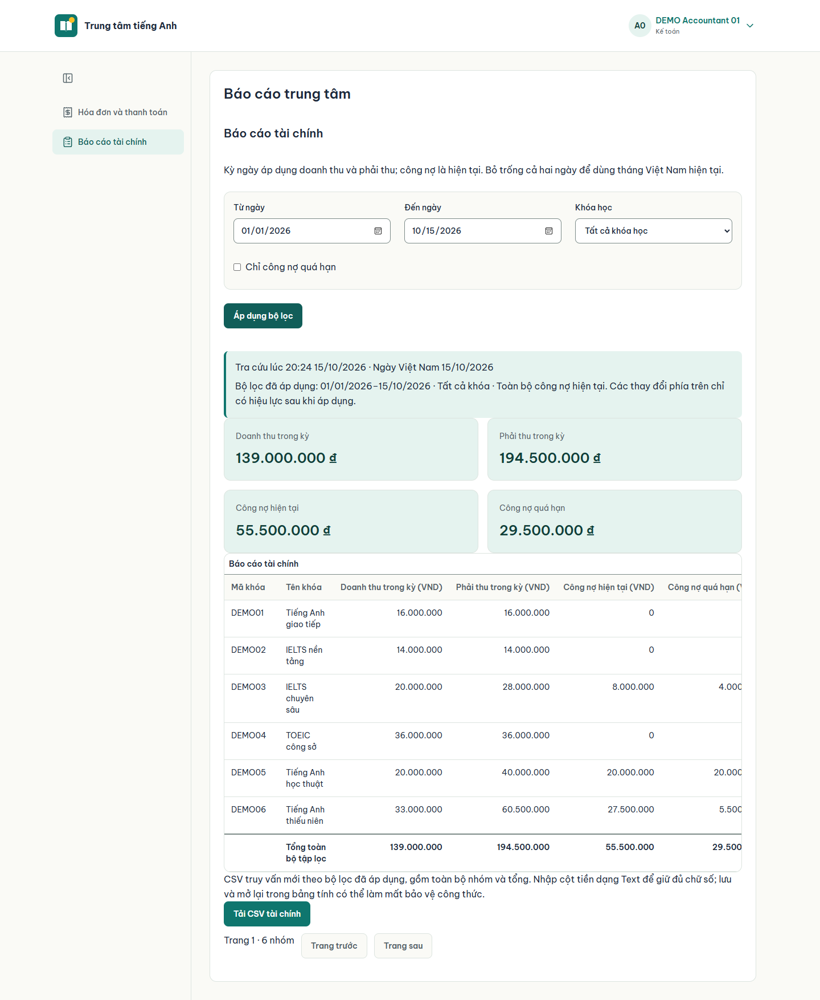

| STT | Loại | Ý nghĩa | Biến cố/Xử lý |
|---|---|---|---|
| 1 | DatePicker | “Từ ngày”, “Đến ngày”. | Chọn kỳ báo cáo; thay đổi tiêu chí chưa đồng nghĩa đã đọc kết quả mới. |
| 2 | ComboBox | “Khóa học”. | Chọn một khóa hoặc Tất cả khóa học để áp dụng trong lần đọc tiếp theo. |
| 3 | CheckBox | “Chỉ công nợ quá hạn”. | Đánh dấu tiêu chí giới hạn phần công nợ theo bộ lọc; không tác động trạng thái hóa đơn. |
| 4 | Button | “Áp dụng bộ lọc”. | Click truy vấn báo cáo tài chính mới và ghi nhận thời điểm tra cứu/bộ lọc đã áp dụng. |
| 5 | Card | Các chỉ số Doanh thu trong kỳ, Phải thu trong kỳ, Công nợ hiện tại, Công nợ quá hạn. | Hiển thị tổng do máy chủ trả về; công nợ hiện tại không bị hiểu thành doanh thu của kỳ. |
| 6 | Table | Bảng nhóm theo khóa và dòng tổng báo cáo. | Chỉ đọc số liệu tổng hợp; không có nút ghi nhận thu tiền trong bảng báo cáo. |
| 7 | Label | Bộ lọc đã áp dụng, thời điểm truy vấn và số nhóm. | Cho biết ngữ cảnh thật của số liệu đang xem; phân biệt với các tiêu chí mới đang nhập. |
| 8 | Button | “Tải CSV tài chính”. | Click thực hiện truy vấn xuất mới theo bộ lọc đã áp dụng, tải toàn bộ nhóm và tổng trong giới hạn cho phép; không chỉ xuất trang đang hiển thị. |
| 9 | Button | “Trang trước”, “Trang sau”. | Click đọc trang nhóm trước/sau của kết quả đang xem. |

## GD25. Báo cáo tổng hợp của giám đốc

**Vai trò:** Giám đốc. **Mã liên quan:** F31.

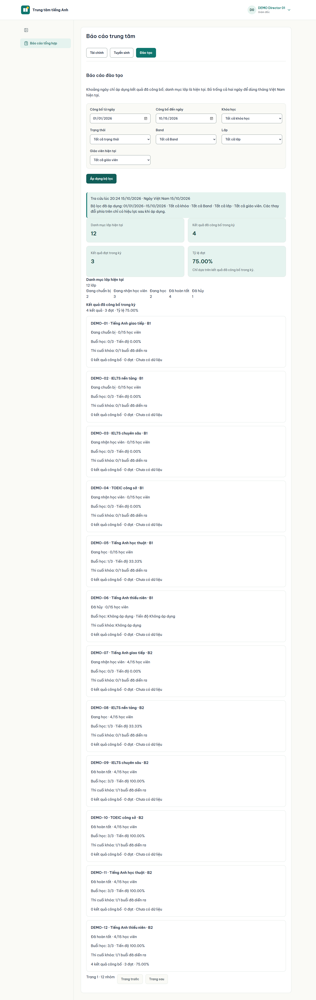

Ảnh bổ sung: [Tài chính](images/094.png), [Tuyển sinh](images/095.png).

| STT | Loại | Ý nghĩa | Biến cố/Xử lý |
|---|---|---|---|
| 1 | Button | “Tài chính”, “Tuyển sinh”, “Đào tạo”. | Click đổi loại báo cáo trong cùng GD25, xóa kết quả cũ và đặt lại bộ lọc; không chuyển sang nghiệp vụ của kế toán/tuyển sinh/giáo vụ. |
| 2 | DatePicker | “Từ ngày/Đến ngày”; với Đào tạo là “Công bố từ ngày/Công bố đến ngày”. | Chọn khoảng thời gian theo ý nghĩa của loại báo cáo; chưa tự truy vấn. |
| 3 | ComboBox | “Khóa học”. | Chọn khóa hoặc toàn bộ khóa cho lần đọc báo cáo tiếp theo. |
| 4 | CheckBox | “Chỉ công nợ quá hạn”, khi xem Tài chính. | Chọn tiêu chí phần công nợ cho báo cáo tài chính. |
| 5 | ComboBox | “Trạng thái”, khi xem Tuyển sinh hoặc Đào tạo. | Chọn trạng thái hồ sơ hoặc lớp theo loại báo cáo. |
| 6 | ComboBox | “Band”, “Lớp”, “Giáo viên hiện tại”, chỉ khi xem Đào tạo. | Chọn các chiều dữ liệu cần giới hạn trong báo cáo đào tạo. |
| 7 | Button | “Áp dụng bộ lọc”. | Click đọc kết quả mới cho loại báo cáo và bộ lọc hiện tại. |
| 8 | Card | Các chỉ số tổng hợp theo loại báo cáo. | Hiển thị doanh thu/công nợ, số hồ sơ/học viên riêng biệt, hoặc số lớp/kết quả công bố/tỷ lệ đạt theo đúng báo cáo. |
| 9 | Table, Card | Các dòng/nhóm dữ liệu theo khóa hoặc lớp. | Chỉ xem số liệu tổng hợp; không mở danh tính học viên riêng, không duyệt hồ sơ hoặc sửa điểm từ báo cáo. |
| 10 | Label | Bộ lọc đã áp dụng và thời điểm tra cứu. | Hiển thị ngữ cảnh số liệu; không coi các ô lọc đang sửa là bộ lọc đã áp dụng. |
| 11 | Button | “Trang trước”, “Trang sau”. | Click đọc trang nhóm trước/sau; giao diện giám đốc không có nút xuất CSV của kế toán. |

## GD26. Quản lý tài khoản và cấp nhân sự

**Vai trò:** Admin. **Mã liên quan:** F32.

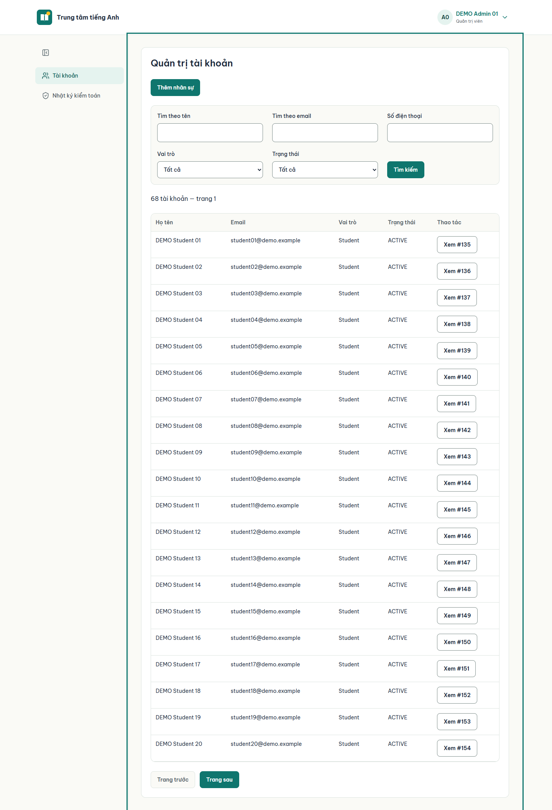

Ảnh bổ sung: [Cấp tài khoản nhân sự](images/062.png), [Chi tiết tài khoản](images/063.png).

| STT | Loại | Ý nghĩa | Biến cố/Xử lý |
|---|---|---|---|
| 1 | TextBox | “Tìm theo tên”, “Tìm theo email”, “Số điện thoại”. | Nhập các tiêu chí riêng để tìm tài khoản, chưa tự truy vấn khi gõ. |
| 2 | ComboBox | “Vai trò”, “Trạng thái”. | Chọn vai trò và trạng thái tài khoản cho lần tìm tiếp theo. |
| 3 | Button | “Tìm kiếm”. | Click đọc danh sách tài khoản theo bộ lọc. |
| 4 | Table | Danh sách họ tên, email, vai trò, trạng thái và thao tác. | Hiển thị thông tin được phép của tài khoản; không hiển thị mật khẩu trong bảng. |
| 5 | Button | “Xem #[mã]”. | Click đọc chi tiết và mở các thao tác được phép ngay trên GD26. |
| 6 | Button | “Thêm nhân sự”. | Click mở hộp thoại “Cấp tài khoản nhân sự”. |
| 7 | TextBox, ComboBox | Họ tên, email đăng nhập, điện thoại tùy chọn và vai trò trong hộp thoại cấp. | Nhập thông tin và chọn một vai trò nhân sự; không dùng hộp thoại này để tự đăng ký học viên. |
| 8 | Button | “Cấp tài khoản”, trong hộp thoại. | Click kiểm tra và tạo nhân sự; thành công hiển thị khối bàn giao mật khẩu tạm một lần. |
| 9 | Button | “Khóa”, “Mở khóa”, “Ngừng sử dụng”, “Kích hoạt lại”, “Đặt lại mật khẩu”. | Click mở hộp thoại xác nhận đúng thao tác cho tài khoản đang chọn; nút chỉ được bật theo quyền và điều kiện bảo vệ tài khoản. |
| 10 | Button | “Xác nhận”, trong hộp thoại thao tác tài khoản. | Click gửi thay đổi. Khóa/ngừng/reset hủy các phiên của tài khoản bị tác động; mở/kích hoạt lại không khôi phục các phiên cũ. |
| 11 | Label | Mật khẩu tạm, chỉ xuất hiện một lần sau cấp/reset thành công. | Chỉ dùng để bàn giao, không phải mật khẩu có thể xem lại từ chi tiết hoặc nhật ký. Bộ ảnh không chứa trạng thái nhạy cảm này. |
| 12 | Button | “Sao chép mật khẩu”, “Đã bàn giao — đóng”, chỉ trong hộp thoại bàn giao. | Click lần lượt sao chép có chủ đích hoặc đóng và xóa mật khẩu tạm khỏi giao diện; không tự phát sinh mật khẩu mới. |
| 13 | Button | “Hủy” biểu mẫu, “Tải lại tài khoản”, “Trang trước”, “Trang sau”. | Lần lượt bỏ bản nhập cấp tài khoản, đọc mới chi tiết hoặc đọc trang danh sách. |

## GD27. Nhật ký kiểm toán và chi tiết thao tác

**Vai trò:** Admin. **Mã liên quan:** F33.

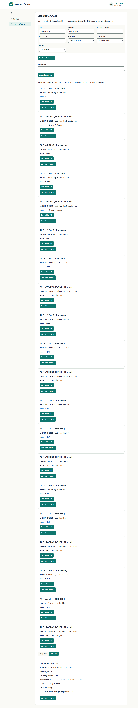

Ảnh bổ sung: [Danh sách nhật ký](images/064.png), [Nhóm thao tác](images/066.png).

| STT | Loại | Ý nghĩa | Biến cố/Xử lý |
|---|---|---|---|
| 1 | DatePicker | “Từ ngày”, “Đến ngày”. | Chọn khoảng thời gian sự kiện, chưa truy vấn khi chỉ chọn. |
| 2 | TextBox | “Mã người thực hiện”, “Mã đối tượng”. | Nhập mã cần tra cứu; không mở hồ sơ nghiệp vụ theo mã chỉ bằng cách nhập. |
| 3 | ComboBox | “Hành động”, “Loại đối tượng”, “Kết quả”. | Chọn tiêu chí lọc sự kiện. |
| 4 | Button | “Đọc lịch sử kiểm toán”. | Click đọc các sự kiện theo bộ lọc hiện tại. |
| 5 | TextBox | “Mã thao tác”. | Nhập mã thao tác cần đối chiếu nhóm sự kiện. |
| 6 | Button | “Đọc nhóm thao tác”. | Click đọc các sự kiện cùng mã thao tác đang nhập. |
| 7 | Card | Sự kiện: hành động, kết quả, thời điểm, người thực hiện và đối tượng. | Chỉ đọc dữ kiện đã được ghi nhận. |
| 8 | Button | “Xem sự kiện [mã]”. | Click đọc chi tiết sự kiện và hiển thị ngay trong GD27. |
| 9 | Button | “Xem nhóm thao tác”, tại mỗi sự kiện hoặc phần chi tiết. | Click đọc nhóm sự kiện của chính mã thao tác liên quan, không cấp quyền mở dữ liệu nghiệp vụ của đối tượng. |
| 10 | Label | Chi tiết gồm lý do, địa chỉ IP nếu còn lưu và thay đổi trước/sau được phép hiển thị. | Chỉ đọc; một số dữ liệu có thể không được ghi hoặc đã hết thời hạn lưu. |
| 11 | Button | “Trang trước”, “Trang sau”. | Click đọc trang trước/sau của danh sách lọc hoặc nhóm thao tác đang xem. |

## Ghi chú khi đưa vào báo cáo

Chèn ảnh chính rồi đặt bảng mô tả ngay bên dưới. Nếu ảnh quá dài, có thể trình bày phần danh sách và phần chi tiết thành hai hình có hậu tố a/b trong cùng mục GD; vẫn giữ chung bảng và không tăng thành use case mới. Ảnh bổ sung chỉ cần chèn khi đang giải thích biểu mẫu/hộp thoại tương ứng. Bản máy tính dùng cho nội dung chính; ảnh điện thoại trong bộ 117 ảnh dùng ở mục thích ứng thiết bị.

Đây là mô tả hành vi dựa trên mã nguồn và ảnh đã chụp, không phải xác nhận đã thực thi các lệnh ghi trong bảng. Không sửa dữ liệu demo, không chụp mật khẩu tạm và không thay nội dung Word gốc trong công việc này. Các trạng thái chưa có ảnh gồm bản in trình duyệt, khối mật khẩu tạm và biểu mẫu sửa cấu hình chương trình nháp khi demo hiện không có chương trình nháp. Không thêm các thành phần suy đoán như ô tìm chung tên/mã/email/SĐT nếu giao diện thực tế dùng các ô riêng.

## Nguồn đối chiếu

- [Manifest bộ ảnh 117 PNG](../report-screenshots-20261015/manifest.json).
- [Danh mục màn hình trong FUNCTION_SPEC](../design/FUNCTION_SPEC.md), phần 9; [requirements](../requirements.md).
- [Điều hướng theo vai trò](../../frontend/src/app/IdentityApp.tsx) và [đường dẫn được hỗ trợ](../../frontend/src/app/identityNavigation.ts).
- [Đăng nhập](../../frontend/src/features/identity/pages/LoginPage.tsx), [đăng ký](../../frontend/src/features/identity/pages/SignupPage.tsx).
- [Hồ sơ và đặt lịch học viên](../../frontend/src/features/enrollment/StudentEnrollmentPage.tsx), [thẻ trang chủ/khóa](../../frontend/src/features/enrollment/components/StudentOverview.tsx).
- [Hóa đơn học viên](../../frontend/src/features/invoices/StudentInvoicesPage.tsx), [lớp](../../frontend/src/features/classes/ClassesPage.tsx), [lịch](../../frontend/src/features/classes/SchedulesPanel.tsx), [kết quả học viên](../../frontend/src/features/classes/StudentGradesPage.tsx).
- [Tuyển sinh](../../frontend/src/features/admissions/AdmissionsPage.tsx), [ca thi](../../frontend/src/features/entrySessions/pages/EntrySessionPage.tsx), [khóa học](../../frontend/src/features/catalogue/pages/CataloguePage.tsx), [chương trình](../../frontend/src/features/programs/pages/ProgramPage.tsx).
- [Nhiệm vụ đầu vào của giáo viên](../../frontend/src/features/entryTasks/TeacherEntryPage.tsx), [điểm danh](../../frontend/src/features/classes/AttendancePanel.tsx), [sổ điểm](../../frontend/src/features/classes/GradebookPanel.tsx), [duyệt điểm](../../frontend/src/features/classes/GradeReviewPage.tsx).
- [Hóa đơn kế toán](../../frontend/src/features/finance/FinancePage.tsx), [báo cáo](../../frontend/src/features/reports/ReportsPage.tsx), [tài khoản](../../frontend/src/features/administration/pages/StaffAdminPage.tsx), [nhật ký](../../frontend/src/features/audit/AuditPage.tsx).
